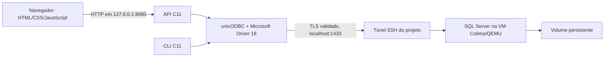

# AquaSense — guia completo do projeto e de execução

Sistema de monitoramento hídrico do **PIM II — Análise e Desenvolvimento de Sistemas, UNIP**. O projeto reúne um cliente de terminal em **C11**, uma **API HTTP em C11** e uma interface em **HTML5, CSS3 e JavaScript**, com persistência no **Microsoft SQL Server pelo ODBC Driver 18**.

A CLI registra temperatura, pH e turbidez e oferece consultas, estatísticas, gráficos ASCII e CSV. A aplicação web acrescenta contas, hidrômetros, leituras acumuladas, consumo, tarifas, estimativas financeiras, categorias, alertas e relatórios. Os registros são manuais: não existe coleta automática de sensores físicos. O SQLite é preservado exclusivamente como origem histórica da migração.

**Nesta cópia do Mac, o SQL Server, os bancos, as credenciais e a extensão web já foram preparados. Siga a execução diária; não repita a inicialização dos bancos.** O ambiente local no Apple Silicon utiliza emulação x86-64 e permanece experimental, destinado a desenvolvimento.

As verificações e ressalvas da segunda auditoria estão em [Auditoria técnica avançada](docs/AUDITORIA_AVANCADA.md). Os documentos históricos registram estados anteriores; seus números de testes não representam necessariamente a revisão atual. Este README reúne o roteiro operacional; os guias vinculados detalham cada componente.

## Índice

1. [Arquitetura e arquivos](#1-arquitetura-e-arquivos)
2. [Pré-requisitos e preservação do ambiente](#2-pré-requisitos-e-preservação-do-ambiente)
3. [Executar tudo no Mac já preparado](#3-executar-tudo-no-mac-já-preparado)
4. [Primeiro acesso e uso da interface](#4-primeiro-acesso-e-uso-da-interface)
5. [CLI, menu, demonstração offline e CSV](#5-cli-menu-demonstração-offline-e-csv)
6. [Parar, retomar e atualizar a aplicação](#6-parar-retomar-e-atualizar-a-aplicação)
7. [Testes e banco isolado](#7-testes-e-banco-isolado)
8. [Conexão a um SQL Server externo](#8-conexão-a-um-sql-server-externo)
9. [CLI no Windows](#9-cli-no-windows)
10. [Preparação inicial de um ambiente novo](#10-preparação-inicial-de-um-ambiente-novo)
11. [Migração, backup e persistência](#11-migração-backup-e-persistência)
12. [Solução de problemas](#12-solução-de-problemas)
13. [Roteiro de apresentação acadêmica](#13-roteiro-de-apresentação-acadêmica)
14. [Limitações e documentação complementar](#14-limitações-e-documentação-complementar)

## 1. Arquitetura e arquivos



O frontend é servido pela API, na mesma origem. Não exige npm, framework ou servidor de frontend separado. Abrir `frontend/index.html` diretamente não fornece login nem conexão com o banco.

| Arquivo/pasta | Responsabilidade |
| --- | --- |
| `monitoramento.c` | Menu e comandos da CLI |
| `input.c/h`, `config.c/h` | Entrada, validação e configuração da conexão |
| `db_odbc.c/h`, `db_odbc_internal.h`, `odbc_diag.c/h` | Conexão, statements, timeouts, diagnóstico e limpeza ODBC |
| `reports_odbc.c/h`, `report_input.c/h`, `csv_report.c/h` | Relatórios parametrizados, períodos, paginação e CSV |
| `demo.c/h`, `ascii_report.c/h` | Dados demonstrativos offline e gráficos de terminal |
| `backend/` | HTTP, autenticação, serviços web, acesso SQL e cálculo de consumo |
| `frontend/` | Interface estática e exportação no navegador |
| `sql/` | Modelo físico, versões, permissões, consultas, evolução e verificações |
| `scripts/` | Diagnóstico, compilação e operação local |
| `tests/` | Testes C, scripts, frontend e integração real |
| `migration/` | Exportador SQLite e pacotes de importação revisados |
| `legacy/`, `arquivos_recebidos/` | Originais e materiais históricos preservados; parte dos artefatos é local e não acompanha o Git |
| `examples/` | Exemplos de conexão sem senha fixa |
| `build/` | Binários gerados; executar esses arquivos após recompilar |
| `.local/sqlserver/` | Estado privado, credenciais, certificados, logs, PID, backups e venv de integração; ignorado pelo Git |
| `.vscode/` | Tarefas de desenvolvimento já preparadas |
| `docs/` | Guias, arquitetura, modelagem, relatórios e evidências |

| Recurso local | Identificação |
| --- | --- |
| Perfil Colima / contexto Docker | `aquasense` / `colima-aquasense` |
| Container / volume | `aquasense-sqlserver` / `aquasense-sqlserver-data` |
| SQL Server | `localhost:1433`, encaminhado exclusivamente por `127.0.0.1:1433` |
| Uso normal | `MonitoramentoAgua`, interface em [localhost:8080](http://localhost:8080) |
| Integração | `MonitoramentoAguaTest`, interface/API em [localhost:8081](http://localhost:8081) |
| Versões do banco | `SchemaVersions = 3`; extensão separada `WebSchemaVersions = 1` |

As tabelas originais `Leituras`, `Sensores`, `LocaisMonitoramento`, `Alertas` e `SchemaVersions` são preservadas. A extensão web mantém contas, sessões, preferências, hidrômetros, consumo, tarifas, categorias e alertas em tabelas próprias. O [modelo original](docs/MODELAGEM.md) e o [modelo web](docs/web/MODELO_WEB.md) descrevem os relacionamentos.

## 2. Pré-requisitos e preservação do ambiente

Reutilize as ferramentas funcionais deste MacBook Air M4. **Não instale, atualize, reinstale ou reconfigure ferramentas apenas para seguir este guia.** Antes de uma mudança de ambiente, confirme a ausência ou incompatibilidade por leitura, demonstre a necessidade e obtenha autorização explícita, com comandos e impactos. A regra está em [AGENTS.md](AGENTS.md) e [AMBIENTE_MACOS.md](docs/AMBIENTE_MACOS.md).

| Componente existente | Necessidade |
| --- | --- |
| Clang e Apple Command Line Tools | Compilação C11; avisos `-Wall -Wextra -Wpedantic -Wconversion -Wshadow` |
| unixODBC 2.3.14 e Microsoft ODBC Driver 18 | Cabeçalhos/biblioteca e conexão SQL; Driver 18.7.1.1 foi registrado no ambiente |
| json-c e OpenSSL 3 | Compilação e execução da API/autenticação |
| Python 3 | Scripts de operação e testes; migração requer Python 3.9 ou posterior e base de fusos disponível |
| Colima, Lima, Docker CLI e QEMU | Servidor SQL existente no perfil dedicado |
| pyodbc no venv privado | Somente integração Python/SQL; não é dependência da CLI C |
| Node.js | Opcional para testes JavaScript; não é necessário para abrir a interface |
| VS Code, SSMS ou sqlcmd | Ferramentas administrativas opcionais, conforme a plataforma |

O driver ODBC é o **cliente**, não o mecanismo SQL Server. `mssql-tools18`/`sqlcmd` no Mac não são necessários para executar a aplicação; os procedimentos locais administrativos utilizam a ferramenta já presente no container.

Diagnóstico de leitura, na raiz do projeto:

```bash
bash scripts/verificar_ambiente_macos.sh
clang --version
python3 --version
odbc_config --version
odbcinst -q -d
```

O diagnóstico sem opções não inicia conexão de rede. Ele pode indicar parâmetros `AGUA_*` pendentes no Terminal: os wrappers locais os fornecem somente ao processo. Isso não exige copiar senhas nem alterar a configuração global.

Não execute `brew update`, `brew upgrade`, `brew reinstall`, `brew cleanup`, mudanças de PATH, links ou confiança global para tentar resolver um erro. Os scripts reutilizam as bibliotecas existentes. Prefixos alternativos de compilação podem ser informados por `ODBC_PREFIX`, `JSON_C_PREFIX` e `OPENSSL_PREFIX`; o runtime local deste Mac reutiliza OpenSSL 3 no caminho já documentado.

## 3. Executar tudo no Mac já preparado

### Passo 1 — confirmar a pasta ativa

Abra o Terminal:

```bash
cd /Users/arthurgoncalves/Downloads/monitoramento_agua_c_sql
pwd
```

Se mover a cópia, adapte apenas o caminho de `cd`. Execute os comandos seguintes na raiz do AquaSense.

### Passo 2 — conferir e compilar com as ferramentas existentes

```bash
bash scripts/verificar_ambiente_macos.sh
bash scripts/compilar_macos.sh
bash scripts/compilar_web.sh
```

A compilação da CLI reutiliza `build.sh` e gera `build/monitoramento`, `build/aquasense` e `build/diagnostico_conexao`. A compilação web gera `build/aquasense_api`. O frontend não possui etapa de build. Compilar não comprova conexão com SQL Server.

Se a API já estiver ativa e você estiver atualizando o código C, pare-a antes e inicie-a novamente depois da compilação, conforme a seção 6. `start` reutiliza um processo saudável; não carrega automaticamente um binário recompilado.

### Passo 3 — iniciar o SQL Server existente e verificar a CLI

```bash
bash scripts/iniciar_servidor_local.sh
python3 scripts/servidor_local.py status
python3 scripts/servidor_local.py check
```

Aguarde a inicialização terminar: o SQL Server emulado pode levar alguns minutos. O script reutiliza perfil, imagem fixada por digest, volume, credenciais e certificados existentes. `check` executa o diagnóstico C de conexão/TLS, esquema e metadados; não cadastra medições.

**Não execute `inicializar_sql_local.py` no uso diário.** Os bancos desta cópia já existem.

### Passo 4 — verificar a extensão web

```bash
bash scripts/iniciar_web_local.sh --check
```

Se a extensão web e a conta SQL já estiverem disponíveis, prossiga ao passo 5. Apenas se o diagnóstico confirmar uma preparação web ainda necessária, após revisar o estado dos bancos, execute:

```bash
python3 scripts/preparar_web_local.py
bash scripts/iniciar_web_local.sh --check
```

Na primeira preparação, esse script faz backup `COPY_ONLY` com `CHECKSUM`, executa `RESTORE VERIFYONLY`, aplica `sql/007_web_extension.sql` primeiro no banco de testes e depois no de uso, compara as cinco tabelas originais e cria a identidade SQL restrita da API. Backups ficam privados em `.local/sqlserver/backups/`.

Uma preparação registrada é idempotente: não redefine senhas nem reaplica tabelas. O marcador não substitui o diagnóstico de saúde. Execute o script sem argumentos; ele não oferece `--help`. Em caso de falha, preserve bancos, backups e arquivos privados para investigar.

### Passo 5 — iniciar a API e abrir a interface

```bash
python3 scripts/gerenciar_web_local.py start
python3 scripts/gerenciar_web_local.py status
```

Abra [http://localhost:8080](http://localhost:8080). O resultado saudável de `status` informa `API ativa`, `MonitoramentoAgua` e `SQL Server conectado.` A [rota de saúde](http://localhost:8080/api/v1/health) identifica o banco utilizado, sem apresentar credenciais.

A API permanece em segundo plano após fechar o Terminal. O gerenciador verifica processo e banco esperado antes de declarar disponibilidade. `localhost` significa este computador: a aplicação não está exposta a outro computador ou celular.

## 4. Primeiro acesso e uso da interface

### Conta e vínculo do legado

1. Escolha **Criar conta** e informe nome, e-mail e senha de pelo menos 12 caracteres. Não existe usuário humano nem senha padrão.
2. A primeira conta recebe administração local. O vínculo das medições anteriores da CLI é uma escolha explícita, inicialmente desmarcada; selecione-o somente se os registros pertencem à conta.
3. O administrador também pode vincular medições sem proprietário em Configurações. O vínculo não altera IDs, valores ou horários originais. Outras contas consultam seus próprios registros.

A identidade SQL técnica da API é diferente da conta humana; não digite a senha SQL no navegador. Logout revoga a sessão. A interface atual não oferece recuperação ou alteração de senha; não redefina contas ou tabelas para contornar essa limitação.

### Hidrômetro e leituras de consumo

1. Acesse **Configurações → Meus hidrômetros → Cadastrar**. Informe identificação e data/hora reais da instalação.
2. Use **Registrar leitura**, selecione o hidrômetro ativo e informe seu **contador acumulado em m³**, data/hora e observação opcional. Não informe o consumo do intervalo no campo do contador.
3. A primeira leitura estabelece a base. A segunda leitura posterior do mesmo equipamento permite calcular `litros = (contador atual − contador anterior) × 1000`.
4. O contador não pode diminuir; o horário deve ser posterior à última leitura, igual ou posterior à instalação e não futuro. Contadores iguais em instantes diferentes representam consumo zero.
5. Para trocar o equipamento, use **Substituir**: a sequência do novo hidrômetro é independente e o histórico anterior é preservado.

Exemplo apenas explicativo: contadores `125,000 m³` e `125,750 m³`, em instantes sucessivos, representam **750 litros** no intervalo. O programa não cadastra esse exemplo automaticamente. Sem duas leituras válidas, mostra ausência de consumo calculável.

### Tarifas, limites e categorias

- Em **Configurações → Tarifas de água**, cadastre o preço por m³ e o início da vigência conhecidos. Cada intervalo usa a tarifa vigente na sua leitura final. Se faltar cobertura para algum intervalo, o total financeiro fica indisponível; não há preço padrão inventado.
- Em **Limites e parâmetros de alerta**, preencha referências conhecidas. Campos vazios ficam sem referência. Não trate esses limites como normas científicas ou regulatórias.
- Categorias são classificadas manualmente, com volume e origem informada, medida ou estimada. A soma classificada não pode exceder o consumo calculado do intervalo; não há distribuição automática entre categorias.
- Em **Alertas**, acompanhe detalhes e estados **Aberto**, **Em análise** e **Resolvido**. O histórico das alterações é preservado. Possível vazamento é um indício que exige verificação.

### Qualidade, histórico e relatórios

Em **Histórico → Qualidade da água → Registrar qualidade**, informe temperatura, pH e turbidez. A CLI também registra essas medidas; contas e consumo pertencem à extensão web. Medições legadas sem UTC confirmado ficam acessíveis em **Todos os registros** e não entram em filtros UTC. As duas leituras do pacote original v3 tiveram seu fuso confirmado e mantêm o horário original para auditoria.

No navegador, datas locais dos filtros são convertidas para UTC; a data final inclui o dia inteiro, por meio de fim exclusivo. Escolha hidrômetro e período para consumo; o vínculo à conta e o período determinam a qualidade exibida.

Em **Relatórios**, escolha Consumo, Financeiro, Alertas ou Detalhado, gere os dados e exporte CSV. O CSV web utiliza UTF-8 com BOM, `;`, escape de aspas e proteção contra fórmulas. Exportações grandes exigem um período menor quando atingem o limite informado pela aplicação.

**Imprimir / PDF** usa o diálogo do navegador e “Salvar como PDF”. Use um navegador comum para conferir o resultado; a validação de um PDF final não é presumida. Detalhes das telas e regras: [Interface](docs/web/INTERFACE.md) e [Execução web](docs/web/EXECUCAO_LOCAL.md).

## 5. CLI, menu, demonstração offline e CSV

### CLI conectada ao servidor local

```bash
bash scripts/executar_local.sh
```

Esse wrapper fornece credenciais, CA e OpenSSL 3 somente ao processo. Para o servidor local, prefira-o à execução direta do binário conectado, que exigiria configurar o ambiente manualmente.

| Opção | Operação |
| --- | --- |
| 1 | Registrar temperatura, pH e turbidez manualmente |
| 2 | Consultar as dez últimas inserções, por ID decrescente |
| 3 | Encerrar e liberar recursos ODBC |
| 4 | Reconectar explicitamente |
| 5 | Todas as medições por páginas |
| 6 | Medições por período e páginas |
| 7 | Quantidade, médias, mínimos e máximos |
| 8 / 9 | Agrupar por dia / mês |
| 10 | Contar medições |
| 11 | Exportar um relatório para CSV novo |

Exemplos de leitura, sem cadastrar dados:

```bash
bash scripts/executar_local.sh --list
bash scripts/executar_local.sh --page 1 20
bash scripts/executar_local.sh --report stats
bash scripts/executar_local.sh --report daily "2026-10-01T00:00:00" "2026-11-01T00:00:00" utc
bash scripts/executar_local.sh --graph ph
bash scripts/executar_local.sh --export relatorio-qualidade-novo.csv all
```

`--report` e `--export` aceitam `all`, `recent`, `stats`, `daily`, `monthly` e `count`. `--graph` aceita `temperatura`, `ph` e `turbidez`; apresenta médias diárias e limita a exibição a 200 pontos, informando omissões. O gráfico padrão usa UTC; um filtro explícito pode escolher `legacy`.

`--page PAGINA TAMANHO` começa em 1 e aceita de 1 a 200 linhas por página. Os filtros opcionais devem aparecer juntos: `INICIO FIM utc|legacy`. Use `YYYY-MM-DDTHH:MM:SS` ou `YYYY-MM-DD HH:MM:SS`, sem `Z`, offset ou fração. O intervalo é **[início incluído, fim excluído)**. Relatórios sem filtro temporal abrangem as duas referências; agrupamentos mantêm UTC e legado separados.

O cadastro `--insert TEMPERATURA PH TURBIDEZ` **grava no banco selecionado**. Para uso real, forneça medidas verificadas; não use o banco de uso para semear uma demonstração. Na CLI, números usam ponto decimal: temperatura de −20 a 100 °C, pH de 0 a 14 e turbidez não negativa. São limites do protótipo. Texto parcial, vírgula decimal, NaN, infinito, overflow e subnormais não zero são recusados.

O menu recupera entradas inválidas e permanece acessível após falhas recuperáveis. Perda da conexão bloqueia novas operações até a opção 4. Nenhuma gravação é repetida automaticamente; consulte o histórico antes de reenviar uma operação de resultado incerto. Uma gravação confirmada cuja impressão falhe informa o ID por stderr e orienta essa conferência.

Códigos da CLI: `0` sucesso, `1` falha operacional/configuração/saída e `2` argumentos inválidos. Um erro ocorrido no menu mantém o status final de falha, mesmo após reconexão bem-sucedida.

### Demonstração totalmente offline

Depois de compilar a CLI, execute diretamente o binário com `--demo`:

```bash
./build/aquasense --demo
./build/aquasense --demo --list
./build/aquasense --demo --report stats
./build/aquasense --demo --graph ph
./build/aquasense --demo --export demonstracao-nova.csv all
```

Esse modo usa seis leituras fixas em memória, identificadas como fictícias, sem abrir ODBC ou acessar SQL Server. Não oferece cadastro nem comprova integração real. O CSV demonstrativo contém o marcador `demonstrativo=sim`. Use-o para apresentar a CLI sem infraestrutura; ele não representa as medições do usuário.

### CSV da CLI e Excel

A exportação conectada cria **arquivo novo**, recusa sobrescrever um existente e informa falhas de consulta/escrita/fechamento. Usa UTF-8 com BOM, `;`, aspas escapadas, CRLF, vírgula decimal e até 17 algarismos significativos. `NULL` vira campo vazio. O formato demonstrativo mantém ponto nos números e identifica a origem fictícia.

No Excel, importe por **Dados → De Texto/CSV**, confira separador e localidade e trate IDs grandes como **Texto** para preservar os 64 bits. CSVs e logs podem conter dados pessoais; revise antes de compartilhar. Consulte [Relatórios da CLI](docs/RELATORIOS.md).

## 6. Parar, retomar e atualizar a aplicação

### Consultar estado

```bash
python3 scripts/servidor_local.py status
python3 scripts/gerenciar_web_local.py status
```

O estado da VM não substitui o teste de conexão: use `servidor_local.py check`. O gerenciador web verifica também a saúde e o banco esperado; API parada ou sem saúde confirmada retorna falha em `status`.

### Parar preservando todos os dados

```bash
python3 scripts/gerenciar_web_local.py stop
python3 scripts/gerenciar_web_local.py stop --test
python3 scripts/servidor_local.py stop
```

Pare primeiro as APIs e depois o SQL Server/VM. `stop --test` é necessário apenas se a API de testes foi iniciada. Encerrar preserva o volume, bancos, contas, históricos, certificados e credenciais. Para retomar, repita os passos de início da seção 3; não execute bootstrap ou importação novamente.

### Atualizar a API após mudar código C

```bash
python3 scripts/gerenciar_web_local.py stop
bash scripts/compilar_web.sh
python3 scripts/gerenciar_web_local.py start
python3 scripts/gerenciar_web_local.py status
```

Repita o mesmo ciclo com `--test` se estiver atualizando a instância de testes. Alterações em HTML/CSS/JavaScript não exigem compilação; atualize a página. Recompile a CLI por `bash scripts/compilar_macos.sh` quando alterar seus fontes.

### Porta alternativa e primeiro plano

```bash
python3 scripts/gerenciar_web_local.py start --port 8082
python3 scripts/gerenciar_web_local.py status --port 8082
python3 scripts/gerenciar_web_local.py stop --port 8082
```

Use os mesmos argumentos em todas as ações e abra [localhost:8082](http://localhost:8082). O gerenciador não substitui um serviço desconhecido nem encerra processos de outra cópia. A porta SQL local permanece fixa em `127.0.0.1:1433`.

Para depuração, `bash scripts/iniciar_web_local.sh` executa em primeiro plano; nesse modo, `Ctrl+C` encerra a API. `--test` seleciona o banco teste e a porta padrão 8081 também nesse wrapper. Não inicie duas APIs na mesma porta.

## 7. Testes e banco isolado

Resultados reais, casos ignorados e limitações devem ser conferidos no [relatório da auditoria](docs/AUDITORIA_AVANCADA.md). **Mocks aprovados não comprovam SQL Server, autenticação, TLS ou persistência.** Não instale dependências automaticamente para executar testes.

### Testes sem SQL Server

Na raiz, com as dependências já disponíveis:

```bash
python3 tests/run_tests.py
python3 tests/test_demo.py
python3 tests/test_scripts.py
python3 tests/test_local_safety.py
python3 -W error::ResourceWarning -m unittest discover -s migration -p 'test_*.py' -v
python3 tests/web/run_core_tests.py
```

Com Node.js existente:

```bash
node --check frontend/app.js
node tests/web/test_frontend_formats.mjs
node tests/web/test_frontend_behavior.mjs
node tests/web/test_frontend_sessions.mjs
node tests/web/test_frontend_export.mjs
```

O teste puro de consumo pode ser compilado separadamente, sem ODBC nem servidor:

```bash
mkdir -p build
clang -std=c11 -Wall -Wextra -Wpedantic -Wconversion -Wshadow -Ibackend \
    tests/web/test_consumption.c backend/consumption.c -lm -o build/test_consumption
./build/test_consumption
```

Para AddressSanitizer e UndefinedBehaviorSanitizer no ambiente compatível:

```bash
AGUA_TEST_SANITIZERS=1 python3 tests/run_tests.py
AGUA_TEST_SANITIZERS=1 python3 tests/test_demo.py
python3 tests/web/run_core_tests.py --sanitizers
```

Essas execuções verificam acessos de memória e comportamento indefinido; não equivalem a uma certificação de ausência de vazamentos. O runtime Apple utilizado não oferece LeakSanitizer nessa configuração.

### Integração web real — somente banco teste e porta 8081

Com SQL Server e extensão web disponíveis:

```bash
python3 scripts/gerenciar_web_local.py start --test
python3 scripts/gerenciar_web_local.py status --test
curl --fail http://localhost:8081/api/v1/health
AGUA_WEB_TEST_URL=http://localhost:8081 python3 tests/web/test_api.py
python3 scripts/gerenciar_web_local.py stop --test
```

**Confirme `MonitoramentoAguaTest` na resposta de saúde antes de qualquer teste de escrita.** A suíte também exige esse banco e rejeita host externo/porta de uso. Ela cria contas e registros sintéticos únicos e preserva seu histórico. Não a direcione para `MonitoramentoAgua:8080`, não redefina contas e não limpe tabelas para repetir a execução.

### Integração CLI real

```bash
python3 scripts/servidor_local.py test
```

O wrapper reutiliza o venv privado com pyodbc, a CA e a conta restrita do banco `MonitoramentoAguaTest`. A suíte confirma `DB_NAME()` e inclui uma leitura de teste persistente; não execute uma adaptação dessa suíte contra o banco de uso. O teste de hostname divergente depende de alias previamente confirmado para o mesmo servidor; um caso ignorado não vale como aprovação. Condições e resultados: [tests/README.md](tests/README.md) e [Servidor local](docs/SERVIDOR_LOCAL.md).

`sql/test_reports.sql` utiliza tabelas temporárias e verifica T-SQL sem alterar medições permanentes. Execute-o inteiro em uma sessão administrativa/controlada de testes. As suítes antigas `test_schema.sql` e `test_smoke.sql` exigem banco dedicado sem os registros indicados em seus cabeçalhos; não as rode no banco já populado nem apague dados para atender essa condição. Rollback não devolve valores de IDENTITY consumidos.

## 8. Conexão a um SQL Server externo

Use uma instância previamente autorizada, com banco preparado e certificado válido. Os wrappers locais selecionam a infraestrutura do Mac; para um servidor externo, use o binário da CLI com `AGUA_*` ou os exemplos de conexão. Esta configuração não publica a API na rede.

| Variável | Regra/padrão |
| --- | --- |
| `AGUA_SERVER` | DNS ou IPv4, até 253 caracteres, sem `tcp:`, porta ou nome de instância; IPv6 não implementado |
| `AGUA_PORT` | Inteiro 1–65535; padrão 1433 |
| `AGUA_DATABASE` | Letras ASCII, números e `_`, até 128 caracteres; padrão `MonitoramentoAgua` |
| `AGUA_AUTH` | `sql` ou `integrated`; padrão `sql` |
| `AGUA_USER` / `AGUA_PASSWORD` | Obrigatórias em autenticação SQL; não salvar senha no código, argumentos ou Git |
| `AGUA_LOGIN_TIMEOUT` | 1–300 segundos; padrão 5 |
| `AGUA_CONNECTION_TIMEOUT` | 1–300 segundos; padrão 5 |
| `AGUA_QUERY_TIMEOUT` | 1–300 segundos; padrão 10 |

A conexão fixa Driver 18, `Encrypt=yes`, `TrustServerCertificate=no` e `ConnectRetryCount=0`. Não aceita string ODBC livre/DSN para sobrescrever essas regras. O DNS deve corresponder ao certificado e a cadeia emissora precisa ser confiável. Não use opções para ignorar o certificado.

No Mac, entre em **Bash** para executar o bloco seguinte. Os nomes são exemplos, e a senha é solicitada sem eco:

```bash
bash
export AGUA_SERVER='sql.exemplo.interno'
export AGUA_PORT='1433'
export AGUA_DATABASE='MonitoramentoAgua'
export AGUA_AUTH='sql'
export AGUA_USER='agua_cliente'
if IFS= read -r -s -p 'Senha SQL Server: ' AGUA_PASSWORD; then
    printf '\n'
    export AGUA_PASSWORD
    if ./build/monitoramento --check; then
        ./build/monitoramento
    fi
fi
unset AGUA_PASSWORD
exit
```

O menu é aberto somente se o diagnóstico concluir com sucesso. Para uma verificação guiada somente de leitura, configure servidor/usuário e execute `bash scripts/testar_conexao.sh`; o script solicita a senha quando necessário. O administrador deve fornecer a configuração de CA apropriada ao processo para a instância externa. Não reutilize por suposição a CA privada do servidor local.

Autenticação integrada usa `AGUA_AUTH=integrated`, sem usuário/senha SQL. Exige identidade apropriada no Windows; no macOS requer Kerberos/ticket/SPN configurados. O usuário local do Mac não fornece automaticamente essa autenticação. Veja [ODBC](docs/ODBC.md) e [Preparação da infraestrutura](docs/FASE3_PREPARACAO.md).

## 9. CLI no Windows

A rota Windows corresponde à **CLI**, não ao servidor web POSIX nem ao perfil Colima do Mac. Execução e integração nativas no Windows ainda exigem validação específica. `localhost` no Windows é o próprio Windows: o SQL Server restrito ao loopback do Mac não fica acessível de outro computador.

1. No CMD da cópia Windows, execute `scripts\verificar_ambiente_windows.cmd` e confira arquitetura x64, compilador/SDK e Driver 18 existentes. Ausências exigem diagnóstico e autorização antes de instalação.
2. Se já utiliza **MSYS2 UCRT64 x64**, compile nesse terminal:

   ```bash
   bash scripts/compilar_windows_ucrt64.sh
   ```

   O script gera `build/aquasense.exe`, `build/monitoramento.exe` e `build/diagnostico_conexao.exe`, ligados a `odbc32`, e confere runtimes disponíveis. Depois, execute pelo CMD/PowerShell; não copie o binário ARM64 do Mac.
3. Como alternativa, no **Developer Command Prompt x64** com MSVC C11/Windows SDK existentes, use `build.bat`. Essa rota gera `build\monitoramento.exe`. Para o diagnóstico adicional:

   ```bat
   cl /nologo /TC /std:c11 /W4 /utf-8 /D_CRT_SECURE_NO_WARNINGS /I. examples\diagnostico_conexao.c db_odbc.c config.c input.c odbc_diag.c /Fo:build\ /Fe:build\diagnostico_conexao.exe /link odbc32.lib
   ```
4. Configure DNS/porta/banco e identidade restrita de um SQL Server acessível, conforme a seção 8. `scripts\testar_conexao_windows.cmd` solicita a senha por PowerShell sem eco e executa o diagnóstico de leitura; `--no-prompt` exige credencial já fornecida ao ambiente.

Para abrir a CLI com autenticação SQL no PowerShell, sem senha literal:

```powershell
$env:AGUA_SERVER = 'sql.exemplo.interno'
$env:AGUA_PORT = '1433'
$env:AGUA_DATABASE = 'MonitoramentoAgua'
$env:AGUA_AUTH = 'sql'
$env:AGUA_USER = 'agua_cliente'
$aguaSecurePassword = Read-Host 'Senha SQL Server' -AsSecureString
$aguaPasswordPtr = [Runtime.InteropServices.Marshal]::SecureStringToBSTR($aguaSecurePassword)
try {
    $env:AGUA_PASSWORD = [Runtime.InteropServices.Marshal]::PtrToStringBSTR($aguaPasswordPtr)
    .\build\monitoramento.exe --check
    if ($LASTEXITCODE -eq 0) { .\build\monitoramento.exe }
} finally {
    Remove-Item Env:AGUA_PASSWORD -ErrorAction SilentlyContinue
    [Runtime.InteropServices.Marshal]::ZeroFreeBSTR($aguaPasswordPtr)
    $aguaSecurePassword.Dispose()
}
```

O ODBC precisa da senha em memória durante o uso. O bloco evita publicá-la e retira a variável ao terminar. Demonstração offline: `.\build\monitoramento.exe --demo --list`, sem SQL Server. Os testes shell com ferramentas simuladas não certificam essa execução no Windows.

## 10. Preparação inicial de um ambiente novo

**Esta seção não é o uso diário deste Mac.** A autorização de continuidade não autoriza instalar/reconfigurar ferramentas por suposição, contratar serviços pagos ou expor portas. Antes de preparar outra máquina, faça inventário de dependências, compatibilidade, backups e recursos existentes, e obtenha autorização para mudanças necessárias. Não há instalador automático de dependências neste README.

### Novo ambiente local autorizado no Mac

1. Confirme ferramentas existentes, arquitetura, cabeçalhos/bibliotecas e Driver 18. Para a infraestrutura experimental, confirme Colima/Docker/QEMU e o escopo de recursos dedicado.
2. Compile CLI e API pelos scripts da seção 3.
3. Execute `bash scripts/iniciar_servidor_local.sh`. Em ambiente realmente novo, esse comando prepara credenciais/certificados, obtém a imagem e cria os recursos dedicados; em ambiente existente, reutiliza-os. Ele disponibiliza o mecanismo SQL, mas não inicializa os bancos da aplicação.
4. **Somente se ambos os bancos e identidades ainda forem novos**, inicialize com o pacote original revisado:

   ```bash
   python3 scripts/inicializar_sql_local.py --importar-legado
   ```

   Cria os bancos de uso/testes e as contas restritas. Importa as duas leituras originais somente no banco de uso, antes de testes de escrita. O inicializador recusa bancos, logins ou marcador preexistentes. Não é ferramenta de reset ou recuperação. Uma instalação intencionalmente sem legado exige decisão explícita; não omita a importação para reproduzir o conjunto original sem avisar.
5. Execute `python3 scripts/preparar_web_local.py`, confira os backups e faça os diagnósticos CLI/web antes de iniciar a API.
6. Siga os passos de cadastro e uso. Credenciais e dados não acompanham um clone do Git.

Se uma preparação parar pela metade, preserve os recursos e examine o resultado; não apague bancos ou credenciais para forçar nova execução.

### Instância completa externa, administrada separadamente

O administrador confirma suporte, TCP/porta limitada a clientes autorizados, DNS/certificado, conta dedicada e permissões. A aceitação acadêmica de Azure SQL Database ainda depende da instituição; não o considere equivalente por suposição.

| Destino | Sequência administrativa revisada |
| --- | --- |
| Banco novo, modelo completo | `000_create_database.sql` → `modelo_fisico.sql` → `005_permissions_v3.sql` → `validar_integridade.sql` |
| Banco novo, evolução histórica completa | `000` → `001` → `002` → `003` → `004_schema_v3.sql` → `005_permissions_v3.sql` → validação |
| Banco existente v2 | Backup verificado → `004_schema_v3.sql` → `005_permissions_v3.sql` → validação |
| Legado v2 com conversão UTC confirmada | Sequência anterior → `006_legacy_utc.sql` → validação |
| Extensão web | Backup verificado e revisão de `007_web_extension.sql`; versão web separada da CLI |

`modelo_fisico.sql` recusa tabelas de usuário preexistentes; não deve ser usado para substituir um banco. Contas da aplicação recebem apenas os papéis necessários, sem privilégios administrativos. O papel de migração é temporário. Os números dos arquivos não equivalem sempre à versão do esquema.

Use os roteiros [Infraestrutura](docs/INFRAESTRUTURA_SQL_SERVER.md), [Preparação](docs/FASE3_PREPARACAO.md), [Modelagem](docs/MODELAGEM.md) e os cabeçalhos SQL antes de executar. Ferramentas administrativas opcionais devem estar disponíveis e autorizadas; não instale sqlcmd apenas para rodar a CLI.

## 11. Migração, backup e persistência

As duas leituras originais foram preservadas no pacote `migration/prepared_original_v3/`, com snapshot, CSV, manifesto/hashes e `import.sql`. O usuário confirmou `America/Sao_Paulo` para essas linhas; o pacote conserva IDs, medidas e horários originais e registra a conversão UTC. Não deduza o fuso de outras fontes pelo fuso atual do computador.

A migração é uma operação administrativa separada: preservar origem, verificar hashes e manifesto, confirmar destino, fazer backup, aplicar em condição compatível e comparar valores/contagens/metadados após o commit. A primeira importação exige `Leituras` vazia; a repetição do mesmo pacote valida o ledger e não duplica dados. Divergências devem ser investigadas, preservando o histórico.

Para gerar outro pacote **offline em diretório novo**, com Python e base de fusos já existentes:

```bash
python3 migration/export_sqlite.py --source legacy/sqlite/monitoramento_agua.db \
    --output migration/pacote-novo-v3 --schema-version 3 \
    --timezone America/Sao_Paulo --require-utc
```

Esse comando prepara arquivos, não executa a importação SQL. Revise [migration/README.md](migration/README.md) para validação, horários ambíguos/inexistentes, permissões, ledger e evolução do legado v2. Não aplique outro primeiro importador no banco local já migrado.

Antes de alterações com dados existentes, suspenda gravadores, faça backup completo `COPY_ONLY, CHECKSUM`, execute `RESTORE VERIFYONLY ... WITH CHECKSUM` e planeje/teste restauração em destino separado. Os scripts exigem provas de backup compatíveis com o banco; não preencha confirmações sem executar a verificação. A preparação web preserva cópia privada do backup e hashes das tabelas originais.

O backup da preparação representa aquele momento; não é um agendamento de backups futuros. O volume `aquasense-sqlserver-data` contém os bancos, enquanto `.local/sqlserver/` guarda as credenciais e certificados necessários para retomá-los. **Não remova volume, perfil Colima, originais SQLite ou pasta privada para reiniciar o projeto.** Código Git sozinho não transfere banco, contas ou credenciais para outra máquina. Veja também `sql/administracao.sql` e [Servidor local](docs/SERVIDOR_LOCAL.md).

## 12. Solução de problemas

| Sintoma | Verificação e encaminhamento |
| --- | --- |
| Script/arquivo não encontrado | Confira `pwd` e a pasta ativa da seção 3. |
| Binário ausente ou antigo | Recompile pelo wrapper correspondente; para API ativa, pare e inicie de novo após compilar. |
| Cabeçalhos ou bibliotecas ausentes | Confira prefixos e arquitetura das instalações existentes; uma nova instalação exige necessidade demonstrada e autorização. |
| Driver não carrega (`IM002`, `IM003`, `01000`) | Confira `odbcinst -q -d`, unixODBC, Driver 18 e arquitetura; não misture gerenciadores/arquiteturas. |
| Falha OpenSSL/TLS | Use wrappers locais, confira CA/certificado e bibliotecas OpenSSL 3 existentes. Preserve chaves e não desative a validação. |
| `08001`, `HYT00`, `HYT01` | Confira serviço, túnel, DNS, porta, certificado e timeout. Leia também mensagem e código nativo. |
| `28000` / autenticação recusada | Confira identidade, método e permissões; não divulgue senhas em logs ou comandos. |
| Objeto/esquema/permissão (`42000`, `42S02`) | Confira instância, banco e versões CLI 3/web 1. Não reaplique criação em banco existente sem revisar a causa. |
| Bootstrap recusado por recursos existentes | Use o procedimento diário ou diagnostique preparação parcial; não apague recursos para contornar a recusa. |
| `localhost:8080` não abre | Confira SQL, `gerenciar_web_local.py status`, porta escolhida e log privado. Inicie SQL antes da API. |
| Porta web ocupada | Escolha outra porta e repita os mesmos `--port` em start/status/stop; não encerre um serviço desconhecido. |
| SQL 1433 ocupada ou túnel divergente | Preserve o processo existente e revise o perfil/túnel dedicado; não abra acesso externo como solução. |
| API responde, mas banco não confirmado | Verifique health/status, versão e credencial; não declare integração aprovada apenas porque a página abriu. |
| Sessão expirada / acesso negado | Entre novamente. A sessão expira em uma hora; dados locais da sessão anterior não devem ser reutilizados. |
| Login limitado por tentativas | Aguarde a janela informada e confira a conta; não redefina contas por SQL para demonstrar acesso. |
| Consumo indisponível | Confira duas leituras do mesmo hidrômetro, instalação, ordem temporal e contador não decrescente. |
| Custo indisponível | Verifique tarifa vigente na leitura final de todos os intervalos do período. |
| Legado não aparece | Confira vínculo explícito, período e Todos os registros para horários sem UTC confirmado. |
| Cadastro retornou falha de rede/saída | Consulte histórico antes de repetir: o servidor pode ter confirmado a gravação. |
| CSV da CLI já existe | Escolha um novo nome; o programa preserva o arquivo anterior. |
| Download/relatório web não concluiu | Gere novamente após conferir sessão, filtros, saúde e permissão de download; não trate arquivo parcial como relatório válido. |
| Impressão não abriu | Teste navegador comum e confirme a prévia/PDF; não há PDF final presumidamente validado. |

Diagnósticos ODBC mostram operação, SQLSTATE, código nativo e mensagem sanitizada. A sanitização reduz exposição, mas logs e relatórios continuam privados e devem ser revisados antes de compartilhar. O [guia ODBC](docs/ODBC.md) descreve timeouts, estado de sessão e recuperação.

## 13. Roteiro de apresentação acadêmica

1. Mostre finalidade, arquitetura, SQL Server real e separação entre CLI, API e navegador. Identifique a limitação experimental do servidor no Mac ARM.
2. Antes da apresentação, compile, inicie SQL/API e execute os diagnósticos. Confira health/status e o nome do banco.
3. Para demonstrar gravações, use **MonitoramentoAguaTest:8081** e declare que os dados são sintéticos. Crie uma conta de apresentação nesse banco, mantendo o vínculo do legado desmarcado quando não aplicável. Preserve os registros existentes.
4. Demonstre hidrômetro, duas leituras acumuladas, diferença em litros, tarifa com vigência explícita e um relatório. Se demonstrar limites/categorias, explique sua origem manual.
5. Mostre histórico, filtros, CSV e logout. Confira o arquivo baixado; só apresente PDF como concluído após verificar a saída do navegador.
6. Apresente a CLI e, como alternativa sem banco, `./build/aquasense --demo --graph ph`. Diga explicitamente que esse último modo é offline/fictício.
7. Use o relatório da auditoria para distinguir testes executados, ignorados e pendências. Não atribua aos mocks a comprovação de conexão real.
8. Ao terminar, pare a API de testes e as demais APIs iniciadas para a apresentação, depois pare o SQL Server/VM. Preserve dados e credenciais.

## 14. Limitações e documentação complementar

- SQL Server no Mac M4 utiliza Linux x86-64 emulado por QEMU. É um ambiente local experimental; não equivale a uma implantação oficialmente suportada em produção.
- A API é sequencial, usa APIs POSIX e atende somente `127.0.0.1`. Portabilidade web Windows, concorrência sob carga e publicação pública/HTTPS exigem trabalho e validação próprios.
- O HTTP local usa cookie HttpOnly/SameSite e CSRF; a conexão API–SQL usa TLS validado. Não exponha esse servidor de desenvolvimento na internet.
- Não há leitura física de sensores, coleta automática, envio de e-mail/push, recuperação de senha, backup periódico automático ou gravação offline de medições com SQL indisponível.
- Qualidade e limites do protótipo não certificam potabilidade. Possível vazamento não é diagnóstico confirmado. Estimativas financeiras não incluem automaticamente esgoto, tributos, taxas fixas ou faixas progressivas.
- Paginação e exportações não afirmam um snapshot entre consultas diante de alterações concorrentes. Arquivos e resultados precisam ser conferidos nas condições da apresentação.
- Execução nativa Windows, plataforma definitiva de servidor, aceitação de Azure pela instituição e PDF final possuem condições próprias de validação; veja as pendências atuais na auditoria.

| Documento | Conteúdo |
| --- | --- |
| [Auditoria técnica avançada](docs/AUDITORIA_AVANCADA.md) | Segunda auditoria, correções, comandos, matriz e resultados atuais |
| [Guia do projeto](docs/GUIA_PROJETO.md) | Guia complementar e histórico do ambiente |
| [Servidor local](docs/SERVIDOR_LOCAL.md) | Perfil, container, TLS, volume, ferramentas e persistência |
| [Execução web](docs/web/EXECUCAO_LOCAL.md) | Operação da API, preparação e primeiro uso |
| [Interface](docs/web/INTERFACE.md) | Telas, relatórios e exportação no navegador |
| [Contrato web](docs/web/CONTRATO_IMPLEMENTACAO.md) / [Modelo web](docs/web/MODELO_WEB.md) | Rotas e regras da extensão |
| [Arquitetura](docs/ARQUITETURA.md) / [Modelagem](docs/MODELAGEM.md) / [Diagrama ER](docs/modelo-er.mmd) | Implementação e modelo de dados original |
| [Relatórios da CLI](docs/RELATORIOS.md) / [ODBC](docs/ODBC.md) | Consultas, CSV, conexão e recuperação |
| [Testes](tests/README.md) / [Histórico de testes](docs/TESTES.md) | Roteiros, pré-condições e registros anteriores |
| [Migração](migration/README.md) | Originais, hashes, pacotes, UTC e importação |
| [Ambiente macOS](docs/AMBIENTE_MACOS.md) / [Scripts de ambiente](docs/FASE2_AMBIENTE.md) | Diagnóstico e preservação das ferramentas |
| [Preparação da instância](docs/FASE3_PREPARACAO.md) / [Infraestrutura](docs/INFRAESTRUTURA_SQL_SERVER.md) | Instância externa e decisões ainda necessárias |
| [Consulta à instituição](docs/CONSULTA_INSTITUICAO.md) | Equivalência acadêmica de Azure ainda não definida |
| [Organização](docs/ORGANIZACAO_PROJETO.md) / [Revisão anterior](docs/REVISAO_FINAL.md) | Materiais recebidos e histórico preservado |

Não crie commits nem publique código, relatórios, credenciais, chaves ou dados pessoais sem autorização. A configuração privada deve continuar fora do Git.
