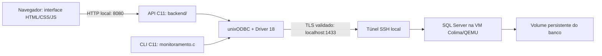

# AquaSense — documentação do projeto e guia de execução

Atualizado em **14/10/2026**. Este guia descreve o código e o ambiente local verificados nessa data, no MacBook Air M4. Os comandos devem ser executados na raiz de `monitoramento_agua_c_sql`.

## 1. O que é o projeto

O AquaSense acompanha consumo de água e medições de temperatura, pH e turbidez. Possui uma interface web e um cliente de terminal em C11. Ambos utilizam Microsoft SQL Server para persistência; o SQLite original é preservado como origem histórica da migração.

Na interface web é possível criar uma conta, cadastrar hidrômetros, registrar leituras acumuladas, acompanhar diferenças de consumo, configurar tarifas e limites, classificar volumes por categoria, consultar histórico, acompanhar alertas e gerar relatórios. O cadastro das medidas é manual. Não há coleta automática de sensores físicos.

As medições de qualidade e os limites configurados não certificam potabilidade. A estimativa financeira não substitui a conta da concessionária; um alerta de possível vazamento é um indício que precisa de verificação.

### Qual procedimento seguir

| Situação | Procedimento |
| --- | --- |
| Usar este Mac, que já está preparado | [Início rápido](#2-início-rápido-no-mac-já-configurado) |
| Retomar depois de reiniciar o computador | Repetir o início rápido |
| Configurar um ambiente novo no Mac Apple Silicon | [Preparação inicial](#5-preparação-inicial-em-outro-mac-apple-silicon) |
| Fazer o primeiro cadastro e começar a registrar dados | [Primeiro uso](#6-primeiro-uso-pela-interface) |
| Resolver erro ao iniciar ou registrar dados | [Solução de problemas](#11-solução-de-problemas) |

## 2. Início rápido no Mac já configurado

O banco, as credenciais SQL e os certificados deste Mac já foram preparados. Para o uso diário, basta iniciar os serviços.

### Passo 1 — abrir a pasta correta

Abra o Terminal e execute:

```bash
cd /Users/arthurgoncalves/Downloads/monitoramento_agua_c_sql
```

Essa é a pasta do AquaSense. A pasta `IdeaProjects/screenmatch/src` pertence a outro projeto. Se mover esta cópia, adapte o caminho do comando `cd`.

### Passo 2 — iniciar o SQL Server

```bash
bash scripts/iniciar_servidor_local.sh
```

O script inicia ou reutiliza a VM Colima, o container SQL Server e o túnel local, aguardando a disponibilidade do banco. A inicialização emulada pode levar alguns minutos. Aguarde o comando terminar com sucesso antes do próximo passo.

### Passo 3 — iniciar a aplicação web

```bash
python3 scripts/gerenciar_web_local.py start
```

A API fica em segundo plano e serve também o HTML, CSS e JavaScript. Fechar o Terminal ou a conversa não encerra esse processo. O início reutiliza um processo já saudável.

### Passo 4 — confirmar o funcionamento

```bash
python3 scripts/gerenciar_web_local.py status
```

O resultado esperado contém:

```text
API ativa | http://localhost:8080 | MonitoramentoAgua
SQL Server conectado.
```

### Passo 5 — abrir a interface

Abra [http://localhost:8080](http://localhost:8080) no navegador deste Mac. A tela inicial oferece **Entrar** e **Criar conta**. Siga o [primeiro uso](#6-primeiro-uso-pela-interface) se ainda não possui uma conta.

`localhost` refere-se ao próprio computador. O servidor atual atende somente `127.0.0.1`, portanto esse endereço não abre o projeto em outro computador ou celular. Abrir `frontend/index.html` como arquivo não fornece conexão com a API.

### Se o executável estiver ausente

Compile a API com as ferramentas existentes e repita o início:

```bash
bash scripts/compilar_web.sh
python3 scripts/gerenciar_web_local.py start
```

Para restaurar também os executáveis da CLI e do diagnóstico C:

```bash
bash scripts/compilar_macos.sh
```

Os comandos de inicialização dos bancos e de preparação da extensão web não fazem parte do uso diário.

## 3. Arquitetura e organização



O frontend não exige Node.js, npm ou um servidor separado. A API C11 recebe requisições HTTP, valida sessões e dados, executa consultas parametrizadas e retorna JSON. O cliente C conecta pelo unixODBC e pelo Microsoft ODBC Driver 18. Os scripts Python e shell cuidam da compilação, da infraestrutura local e da configuração privada.

| Pasta ou arquivo | Responsabilidade |
| --- | --- |
| `frontend/index.html`, `styles.css`, `app.js`, `favicon.svg` | Interface web e exportação CSV no navegador |
| `backend/web_server.c` | HTTP, arquivos estáticos, validação de requisições e rotas |
| `backend/web_auth.c` | Contas, senhas, sessões e autenticação |
| `backend/web_domain.c` | Consumo, qualidade, tarifas, categorias, alertas e relatórios |
| `backend/consumption.c` | Conversão e cálculo exato do consumo em litros |
| `backend/web_support.c` | Execução SQL parametrizada e conversão dos resultados |
| `monitoramento.c` e módulos C na raiz | Menu, conexão ODBC e relatórios do terminal |
| `sql/` | Esquema, permissões, evolução e consultas SQL |
| `scripts/` | Compilação e operação do servidor local |
| `tests/` | Testes do núcleo, scripts, frontend e integração |
| `migration/` e `legacy/` | Pacotes de migração e arquivos históricos preservados |
| `build/` | Executáveis gerados pela compilação |
| `.local/sqlserver/` | Credenciais, certificados, logs, PID e backups privados; fora do Git |

### Bancos e modelo de dados

| Recurso | Uso |
| --- | --- |
| `MonitoramentoAgua` | Contas e dados de uso local |
| `MonitoramentoAguaTest` | Contas e dados de integração; separados do banco de uso |
| `SchemaVersions = 3` | Versão do esquema original compatível com a CLI |
| `WebSchemaVersions = 1` | Versão independente da extensão web |
| `Leituras` | Medições de temperatura, pH e turbidez, incluindo o legado |
| `WebUsuarios`, `WebSessoes`, `WebPreferencias` | Contas, autenticação e configurações pessoais |
| `WebMedidores`, `WebLeiturasConsumo` | Hidrômetros e seus contadores acumulados |
| `WebTarifas` | Valores por m³ com início de vigência |
| `WebQualidadeUsuarios` | Vínculo das medições de qualidade com uma conta |
| `WebCategoriasConsumo`, `WebRegistrosCategoria` | Categorias e volumes classificados explicitamente |
| `WebAlertas`, `WebAlertasHistorico` | Ocorrências, status e auditoria de alterações |

As tabelas originais, incluindo `Sensores`, `LocaisMonitoramento` e `Alertas`, são preservadas. As medições do terminal só aparecem na conta web após um vínculo explícito; esse vínculo não altera medidas, IDs ou horários. O [modelo web](web/MODELO_WEB.md) detalha relacionamentos e regras.

## 4. Ferramentas e requisitos

O ambiente deste Mac já possui os componentes abaixo. As versões são as observadas em 14/10/2026, e não uma exigência de atualizar outras instalações para a versão mais recente.

| Componente | Versão ou configuração verificada | Finalidade |
| --- | --- | --- |
| Clang e Apple Command Line Tools | Compilação C11 | Compilar CLI, API e diagnósticos |
| Python | 3.14 | Executar scripts de operação e testes |
| Homebrew | Prefixo `/opt/homebrew` | Localizar as bibliotecas e ferramentas existentes |
| unixODBC | 2.3.14 | Gerenciador ODBC, cabeçalhos e bibliotecas C |
| Microsoft ODBC Driver | 18.7.1.1 | Conexão com SQL Server |
| json-c | 0.19 | Leitura e geração de JSON na API |
| OpenSSL 3 | 3.6.1 | Criptografia da autenticação e bibliotecas TLS compatíveis |
| Colima / Lima | 0.10.3 / 2.2.1 | VM Linux dedicada ao projeto |
| Lima guest agents | 2.2.1 | Componentes usados pela VM x86-64 |
| Docker CLI | 29.9.0 | Operar o container no contexto dedicado |
| QEMU | 11.1.2 | Emulação x86-64 no Apple Silicon |
| SSH | Ferramenta do sistema | Túnel privado para a porta do SQL Server |
| SQL Server | 2022 Developer, `16.0.4305.5` | Persistência dos dados |

O perfil `aquasense` usa 4 CPUs, 6 GiB de memória e disco virtual de 30 GiB. O container tem limite de 5 GiB, com 4096 MiB configurados para o SQL Server. Considere esses recursos ao usar o Mac junto de outras aplicações. A primeira preparação exige internet para obter a imagem e os componentes da VM.

O Driver ODBC é um cliente; sua instalação, sozinha, não cria um servidor SQL Server. O `sqlcmd` usado pelos scripts está dentro da imagem do servidor. Sua instalação no Mac é opcional. `pyodbc` é necessário somente à suíte antiga de integração Python/C; Node.js é opcional para os testes de formatação do frontend.

### Conferir as ferramentas sem instalar

```bash
bash scripts/verificar_ambiente_macos.sh
python3 --version
brew list --versions unixodbc msodbcsql18 json-c openssl@3 colima lima docker qemu lima-additional-guestagents
odbcinst -q -d
```

O registro ODBC deve incluir `[ODBC Driver 18 for SQL Server]`. O verificador genérico pode informar variáveis `AGUA_*` pendentes quando executado diretamente: os wrappers locais as montam somente no processo da aplicação. Para validar a conexão configurada, use os comandos de diagnóstico da seção 7; não é necessário exportar senhas no Terminal.

## 5. Preparação inicial em outro Mac Apple Silicon

Use esta seção somente para um ambiente novo, com as ferramentas compatíveis disponíveis. **Neste Mac, siga o início rápido.** O runtime atual assume Homebrew em `/opt/homebrew`; mudar apenas os prefixos da compilação não torna toda a infraestrutura portátil para Intel, Linux ou Windows.

Os nomes do perfil, contexto, container e volume são fixos por computador. Um segundo checkout no mesmo Mac não representa uma instalação isolada. Se já existem recursos AquaSense, preserve-os e revise o ambiente antes de preparar outra cópia.

### Passo 1 — obter o projeto e conferir os requisitos

Para uma instalação nova, use uma cópia do código e dos artefatos históricos, sem transportar `.local/sqlserver/` de outra instalação. Os marcadores antigos não inicializam um banco novo. Transferir contas e registros existentes exige um procedimento de backup e restauração, preservando as credenciais e certificados correspondentes. Entre na raiz usando o caminho real da nova cópia:

```bash
cd /caminho/do/monitoramento_agua_c_sql
bash scripts/verificar_ambiente_macos.sh
```

Se faltar uma ferramenta, providencie apenas o componente ausente. Os scripts do projeto não instalam dependências. Consulte a [instalação oficial do Homebrew](https://docs.brew.sh/Installation), a [instalação do Colima](https://colima.run/docs/installation/) e a [instalação do Driver 18 no macOS](https://learn.microsoft.com/en-us/sql/connect/odbc/linux-mac/install-microsoft-odbc-driver-sql-server-macos?view=sql-server-ver17). O Driver deve corresponder à arquitetura do Terminal. Não há necessidade de reinstalar ferramentas funcionais para seguir este guia.

Para reproduzir as duas leituras históricas, a cópia também precisa conter `legacy/sqlite/monitoramento_agua.db` e o pacote completo `migration/prepared_original_v3/`, incluindo o snapshot SQLite. Arquivos `.db` são ignorados pelo Git; um checkout Git isolado pode não conter esses artefatos. O inicializador confere seus hashes antes de importar.

### Passo 2 — compilar os executáveis

```bash
bash scripts/compilar_macos.sh
bash scripts/compilar_web.sh
```

A compilação gera `build/aquasense`, `build/diagnostico_conexao` e `build/aquasense_api`. A API exige os cabeçalhos de unixODBC, json-c e OpenSSL 3. `ODBC_PREFIX`, `JSON_C_PREFIX` e `OPENSSL_PREFIX` permitem selecionar bibliotecas existentes para a compilação; o runtime local continua usando `/opt/homebrew/opt/openssl@3/lib`.

### Passo 3 — criar e iniciar a infraestrutura local

```bash
bash scripts/iniciar_servidor_local.sh
```

No primeiro início, o script prepara o estado privado, credenciais e certificados, cria o perfil dedicado e obtém a imagem do SQL Server. Em inícios posteriores, reutiliza os recursos. Essa etapa disponibiliza o mecanismo SQL Server, mas ainda não cria os bancos do aplicativo.

### Passo 4 — inicializar os bancos novos

Para reproduzir o projeto incluindo suas duas leituras originais:

```bash
python3 scripts/inicializar_sql_local.py --importar-legado
```

Esse comando cria `MonitoramentoAgua` e `MonitoramentoAguaTest`, aplica o esquema original e configura as identidades restritas da CLI. Importa e verifica o pacote histórico somente no banco de uso. Se deseja deliberadamente um ambiente novo sem essas leituras, execute o comando sem `--importar-legado`.

O inicializador recusa marcador, bancos ou logins preexistentes. Ele não é um comando de reinicialização nem de recuperação. Se houver falha ou recursos existentes, preserve os arquivos e bancos para diagnóstico; não os apague para repetir o procedimento.

### Passo 5 — preparar a extensão web

```bash
python3 scripts/preparar_web_local.py
```

A preparação executa backup `COPY_ONLY` com `CHECKSUM`, verifica sua leitura com `RESTORE VERIFYONLY` e aplica `sql/007_web_extension.sql`, primeiro em testes e depois no banco de uso. Confere a preservação das cinco tabelas originais e cria a identidade SQL restrita da API. Os backups ficam em `.local/sqlserver/backups/`.

Quando existe o registro `web-initialized.json`, o script retorna sem reaplicar a extensão ou redefinir senhas. Esse retorno não substitui uma verificação da saúde do banco. O script de preparação não implementa `--help`; use exatamente o comando apresentado.

### Passo 6 — verificar e abrir a aplicação

```bash
python3 scripts/servidor_local.py check
bash scripts/iniciar_web_local.sh --check
python3 scripts/gerenciar_web_local.py start
python3 scripts/gerenciar_web_local.py status
```

Abra [http://localhost:8080](http://localhost:8080). O navegador deve mostrar a tela de acesso; `status` deve indicar SQL Server conectado. Não há conta humana ou senha padrão.

## 6. Primeiro uso pela interface

### Passo 1 — criar a conta

Na tela inicial, clique em **Criar conta**. Informe nome, e-mail e senha de pelo menos 12 caracteres. A primeira conta recebe administração local. O cadastro não envia e-mail de confirmação, e a interface atual não oferece recuperação ou alteração de senha.

No cadastro da primeira conta, há uma opção explícita para vincular as medições anteriores do terminal. Ela começa desmarcada: selecione-a somente se essas medições devem pertencer à sua conta. O administrador também pode fazer esse vínculo em Configurações. Outras contas acessam seus próprios dados.

### Passo 2 — cadastrar um hidrômetro

Entre em **Configurações → Meus hidrômetros → Cadastrar**. Informe nome, código de identificação e data/hora de instalação. A leitura deve ocorrer no mesmo instante da instalação ou depois dele. O medidor precisa estar ativo para receber novos registros.

Ao substituir um equipamento, use **Substituir**. O novo hidrômetro recebe uma sequência independente; o histórico do anterior é preservado.

### Passo 3 — registrar as leituras de consumo

Use **Registrar leitura** no painel de consumo ou no histórico. Selecione o hidrômetro e informe o contador acumulado em **m³**, a data/hora e, se necessário, uma observação. Registre valores reais em ordem temporal, sem separador de milhar; a apresentação decimal acompanha o navegador.

A primeira leitura é uma base e ainda não determina consumo. A partir da segunda, o sistema calcula:

```text
consumo em litros = (contador atual em m³ − contador anterior em m³) × 1000
```

Exemplo didático, sem cadastro automático de dados:

| Leitura | Contador acumulado | Resultado |
| --- | --- | --- |
| Primeira | 125,000 m³ | Base; consumo ainda desconhecido |
| Segunda, em instante posterior | 125,750 m³ | 750 litros consumidos no intervalo |

O contador não pode diminuir, a data não pode repetir ou preceder a última leitura, e datas futuras são rejeitadas. Um contador igual em instantes diferentes representa zero consumo. Sem intervalos calculáveis, o painel informa ausência de dados em vez de inventar um total.

### Passo 4 — configurar a tarifa

Em **Configurações → Tarifas de água**, informe o preço por m³ e o início de sua vigência. Para calcular um intervalo, deve existir tarifa vigente na data de sua leitura final. Uma nova tarifa preserva as vigências anteriores.

O custo estimado é a soma de `litros ÷ 1000 × tarifa vigente` de cada intervalo. Se faltar tarifa em algum deles, o total fica indisponível e a aplicação informa a cobertura ausente. Não são incluídos esgoto, taxas fixas, tributos ou faixas progressivas.

### Passo 5 — definir limites e acompanhar alertas

Em **Configurações → Limites e parâmetros de alerta**, preencha apenas referências conhecidas: limites diário/mensal, limiar de consumo contínuo e referências de qualidade. Campos vazios permanecem sem referência. A consulta do painel, dos alertas ou de seu relatório avalia os dados persistidos contra essas configurações.

Em **Alertas**, abra **Detalhes** para acompanhar uma ocorrência e alterar seu status para aberto, em análise ou resolvido. As transições permanecem no histórico. Um indício de vazamento exige quatro leituras do mesmo hidrômetro formando três intervalos consecutivos de até uma hora acima do limiar configurado; leituras esparsas não sustentam esse alerta.

### Passo 6 — registrar e consultar qualidade

Entre em **Histórico → Qualidade da água → Registrar qualidade** e informe temperatura em °C, pH e turbidez. O cadastro web usa o instante atual da medição. A avaliação depende das referências que você configurou.

Em **Histórico**, escolha período, ordenação e página. O filtro de hidrômetro se aplica ao consumo; as medições de qualidade são vinculadas à conta e filtradas por período. **Todos os registros** também permite visualizar legado sem horário UTC confirmado. Filtros por período excluem esse legado sem confirmação, preservando sua data original.

### Passo 7 — classificar volumes por categoria

No acompanhamento de consumo, use a classificação de uma leitura com consumo calculado. Escolha Banho, Lavagem, Cozinha, Sanitários ou Outros, informe o volume e indique sua origem: informada, medida ou estimada. A soma classificada não pode exceder o consumo do intervalo. Não há distribuição automática entre categorias.

### Passo 8 — gerar e exportar relatórios

Em **Relatórios**, selecione Consumo, Financeiro, Alertas ou Detalhado, ajuste o período e gere o resultado. Use **Exportar CSV** para salvar os dados. O CSV usa UTF-8 com BOM e separador `;`, preservando valores decimais.

Para PDF, abra a aplicação em um navegador comum, gere o relatório e use **Imprimir / PDF → Salvar como PDF**. A saída depende do diálogo de impressão do navegador. Na validação do navegador integrado do Codex, esse diálogo não apareceu; nenhum PDF final foi gerado ou validado.

## 7. Consultar estado, diagnosticar e encerrar

### Estado dos serviços

```bash
python3 scripts/servidor_local.py status
python3 scripts/gerenciar_web_local.py status
```

O primeiro informa VM, container e túnel. O segundo verifica a API e sua conexão com o banco esperado. Uma API parada retorna código de saída diferente de zero em `status`.

### Verificar conexão sem abrir a interface

```bash
python3 scripts/servidor_local.py check
bash scripts/iniciar_web_local.sh --check
```

O diagnóstico C exige o executável gerado por `compilar_macos.sh`. O diagnóstico web exige `build/aquasense_api`. Também é possível consultar [a saúde da API](http://localhost:8080/api/v1/health), que informa o banco e as versões dos esquemas, sem retornar credenciais.

### Encerrar preservando os dados

Primeiro pare a API, depois o SQL Server e a VM:

```bash
python3 scripts/gerenciar_web_local.py stop
python3 scripts/servidor_local.py stop
```

Se também iniciou a API de testes, execute `python3 scripts/gerenciar_web_local.py stop --test` antes de parar o SQL Server. O gerenciador encerra somente um processo identificado como pertencente a esta cópia do projeto.

O banco fica no volume `aquasense-sqlserver-data`; credenciais e certificados ficam em `.local/sqlserver/`. **Não exclua o volume, o perfil Colima ou a pasta privada para reiniciar a aplicação.** Para retomar, use os passos da seção 2. Não há configuração de início automático após reiniciar o Mac.

### Porta alternativa ou execução em primeiro plano

Se a porta web 8080 estiver ocupada, escolha outra porta e use os mesmos argumentos nas três ações:

```bash
python3 scripts/gerenciar_web_local.py start --port 8082
python3 scripts/gerenciar_web_local.py status --port 8082
python3 scripts/gerenciar_web_local.py stop --port 8082
```

Nesse caso, abra `http://localhost:8082`. O gerenciador não encerra um serviço desconhecido que ocupa a porta. Para depuração em primeiro plano, use `bash scripts/iniciar_web_local.sh`; somente nesse modo `Ctrl+C` encerra a API vinculada ao Terminal.

## 8. Cliente de terminal e demonstração offline

Com o SQL Server iniciado, abra o menu da CLI:

```bash
bash scripts/executar_local.sh
```

Para listar medições de qualidade ou exibir seu gráfico ASCII de pH:

```bash
bash scripts/executar_local.sh --list
bash scripts/executar_local.sh --graph ph
```

Os gráficos também aceitam `temperatura` e `turbidez`. A CLI mantém as 11 opções de cadastro, consulta e relatórios de qualidade; as funções de contas e consumo estão na aplicação web.

Para conhecer a CLI sem conexão com o SQL Server, depois de compilá-la:

```bash
./build/aquasense --demo --list
./build/aquasense --demo --graph ph
```

O modo `--demo` usa dados fixos identificados como demonstrativos, não grava no banco e não representa consumo ou qualidade medidos pelo usuário. Consulte [relatórios da CLI](RELATORIOS.md) para filtros, paginação e CSV.

## 9. Desenvolvimento e testes

Depois de alterar código C da API, pare o processo, compile e inicie novamente para carregar o novo executável:

```bash
python3 scripts/gerenciar_web_local.py stop
bash scripts/compilar_web.sh
python3 scripts/gerenciar_web_local.py start
```

Alterações no HTML/CSS/JavaScript não exigem compilação; atualize a página. O VS Code também oferece tarefas de compilação, preparação e início local em `.vscode/tasks.json`.

### Verificações sem banco

```bash
python3 tests/run_tests.py
python3 tests/test_scripts.py
python3 tests/web/run_core_tests.py
```

Com Node.js disponível, a verificação de formatação e CSV é:

```bash
node tests/web/test_frontend_formats.mjs
```

O núcleo web pode ser verificado com AddressSanitizer e UndefinedBehaviorSanitizer usando `python3 tests/web/run_core_tests.py --sanitizers`. O runtime Apple não oferece LeakSanitizer nesta execução.

### Integração web no banco de testes

Com o SQL Server ativo e a extensão web preparada:

```bash
python3 scripts/gerenciar_web_local.py start --test
python3 scripts/gerenciar_web_local.py status --test
AGUA_WEB_TEST_URL=http://localhost:8081 python3 tests/web/test_api.py
python3 scripts/gerenciar_web_local.py stop --test
```

A suíte exige confirmar `MonitoramentoAguaTest` pela rota de saúde antes de gravar. Cria contas e dados sintéticos no banco de testes e preserva esse histórico. Não a direcione ao banco de uso. Em primeiro plano, o equivalente exige `bash scripts/iniciar_web_local.sh --test --port 8081`, pois somente o gerenciador seleciona automaticamente a porta 8081.

Em 14/10/2026, passaram 19 testes HTTP/SQL Server reais, 344 verificações do núcleo HTTP/autenticação, 88 verificações de formatação do frontend, 38 de consumo, 12 de demonstração, 75 do cliente C e 44 dos scripts. Também foram verificados login, navegação, cadastro e dois downloads CSV no navegador, com dados sintéticos somente em testes. Os resultados completos e seus limites estão no [relatório de entrega](web/RELATORIO_ENTREGA.md).

As suítes SQL antigas `test_schema.sql` e `test_smoke.sql` exigem banco de teste sem leituras. Não as execute sobre o banco de testes já populado para repetir a demonstração. A integração antiga Python/C, com `pyodbc`, possui seu roteiro em [Servidor local](SERVIDOR_LOCAL.md) e acrescenta uma leitura ao banco teste por execução.

## 10. Configuração privada, segurança e preservação

Os scripts locais selecionam banco, usuário SQL, senha, CA e bibliotecas OpenSSL somente para o processo. A conta do navegador é diferente da identidade técnica SQL usada pela API; não é necessário conhecer ou digitar a senha SQL na interface.

| Item | Localização ou comportamento |
| --- | --- |
| Credenciais SQL | `.local/sqlserver/credentials.json`, permissão `0600` |
| Certificados e chaves | `.local/sqlserver/tls/`, diretório privado |
| Log e PID da API | `.local/sqlserver/web-8080.log` e `web-8080.json`; a porta define o nome |
| Backups da preparação web | `.local/sqlserver/backups/` |
| Dados persistentes | Volume Docker `aquasense-sqlserver-data`, dentro da VM |
| Senha da conta humana | Hash PBKDF2-SHA256, com 600.000 iterações |
| Sessão web | Expira em uma hora; logout revoga a sessão |
| Cookie | HttpOnly e SameSite=Strict; sem senha/token em `localStorage` |
| Mutação autenticada | Exige token CSRF; consultas SQL usam parâmetros |
| Conexão com o SQL Server | `Encrypt=yes` e `TrustServerCertificate=no`, com validação da CA local |

O papel SQL da API permite somente as operações necessárias. Os usuários do navegador são isolados pela API; não recebem acesso SQL direto. O serviço é local e sequencial, sem configuração de publicação ou validação de carga de produção.

O backup executado na preparação da extensão registra o estado daquele momento. Ele não é um agendamento de backup dos dados que forem cadastrados depois. Para mudança de máquina ou recuperação, preserve o banco/backup e os arquivos privados correspondentes, com acesso restrito. Copiar apenas o código do Git não transfere dados, contas ou credenciais. O roteiro administrativo de backup está em `sql/administracao.sql`; restauração exige verificar a instância e o banco de destino antes de qualquer substituição.

Não compartilhe credenciais, chaves, logs ou relatórios com dados pessoais no Git ou em documentação pública. A `.gitignore` já exclui o estado privado e artefatos locais.

## 11. Solução de problemas

| Sintoma | Como verificar e resolver |
| --- | --- |
| Comando não encontra o script | Confira o `cd` da seção 2; execute na raiz do AquaSense. |
| Navegador não abre `localhost:8080` | Execute `gerenciar_web_local.py status`; inicie SQL Server e API nessa ordem. Confira se escolheu outra porta. |
| VM ou container parados | Execute `iniciar_servidor_local.sh` e aguarde sua conclusão. Use `servidor_local.py status` para conferir. |
| `build/aquasense_api` ausente | Execute `bash scripts/compilar_web.sh`. |
| Diagnóstico C ausente | Execute `bash scripts/compilar_macos.sh`. |
| Cabeçalhos ou bibliotecas ausentes | Confira as ferramentas da seção 4 e os prefixos existentes. Instale somente dependência realmente ausente; não altere links globais para testar por tentativa. |
| Driver 18 não encontrado | Confira `odbcinst -q -d`, unixODBC e arquitetura do Terminal. Use o guia oficial do Driver se houver ausência real. |
| Falha TLS ou de carregamento OpenSSL | Execute pelos wrappers locais e preserve `.local/sqlserver/tls/`. O runtime usa OpenSSL 3; não desative a validação do certificado. |
| Banco ou esquema ausente em ambiente novo | Confira se concluiu os passos 4 e 5 da preparação inicial. Em ambiente existente, preserve o estado e investigue a divergência. |
| Inicialização recusada por recursos existentes | Não repita o bootstrap como forma de reset; siga o uso diário ou revise a recuperação. |
| Porta ocupada por outro serviço | Use outra porta web conforme a seção 7. Os scripts não encerram processos desconhecidos; a porta SQL local é fixa em 1433. |
| Código C alterado, mas comportamento antigo | Pare a API, recompile e inicie novamente. `start` reutiliza um processo saudável já ativo. |
| Sessão expirou ou requisição exige autenticação | Entre novamente. O prazo da sessão é de uma hora. |
| Login bloqueado por muitas tentativas | Aguarde a janela de um minuto antes de tentar novamente. Não há recuperação de senha na interface atual. |
| Leitura rejeitada | Confira medidor ativo, data igual ou posterior à instalação e posterior à última leitura, contador não decrescente e ausência de data futura. |
| Consumo ou custo indisponível | Cadastre duas leituras válidas do mesmo medidor; configure tarifa vigente para todos os intervalos do período. |
| Histórico não mostra medições antigas | Confira período e vínculo do legado; no consumo, confira também o hidrômetro. Use Todos os registros para horários sem UTC confirmado. |
| Cadastro retornou falha de conexão | Consulte o histórico antes de reenviar: uma falha de resposta pode deixar incerto se a gravação foi confirmada. |
| CSV não foi baixado | Confira se o relatório foi gerado e se o navegador permite downloads; consulte a pasta Downloads. |
| Imprimir / PDF não abriu diálogo | Tente em navegador comum. A geração de um PDF final ainda não foi validada nesta entrega. |

## 12. Limitações atuais e documentos complementares

O SQL Server no Mac M4 roda em Linux x86-64 emulado por QEMU. Essa execução local foi testada, mas a Microsoft não testa nem oferece suporte a SQL Server em emulação/tradução ARM. Uma implantação definitiva exige plataforma compatível; consulte a [política oficial do SQL Server](https://learn.microsoft.com/en-us/sql/linux/install-upgrade/setup?view=sql-server-ver17).

O backend web usa APIs POSIX e não foi validado no Windows. Também permanecem fora da entrega a publicação pública/HTTPS, recuperação de senha, coleta física de sensores, envio de e-mail/push, política periódica de backup e validação de concorrência sob carga. A preferência de notificações controla o indicador interno de alertas da aplicação. Não há armazenamento offline de novas medições quando o banco está indisponível.

| Documento | Conteúdo |
| --- | --- |
| [README do projeto](../README.md) | Referência geral e histórico de evolução |
| [Execução local web](web/EXECUCAO_LOCAL.md) | Operação específica da API e da interface |
| [Servidor local](SERVIDOR_LOCAL.md) | Colima, Docker, TLS, persistência e testes reais |
| [Interface](web/INTERFACE.md) | Telas, visual e comportamento |
| [Modelo web](web/MODELO_WEB.md) | Entidades e regras de negócio |
| [Contrato de implementação](web/CONTRATO_IMPLEMENTACAO.md) | Rotas HTTP e integração frontend/backend |
| [Relatório de entrega](web/RELATORIO_ENTREGA.md) | Etapas, verificações e pendências comprovadas |
| [Relatórios da CLI](RELATORIOS.md) | Consulta, filtros e exportação pelo terminal |
| [Testes](../tests/README.md) | Roteiros e condições de execução das suítes |
