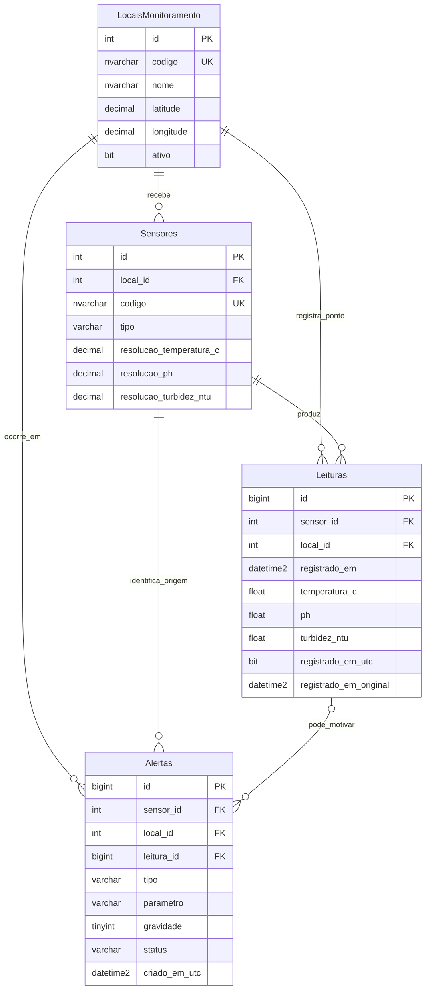

# Modelagem do banco MonitoramentoAgua

O esquema 3 implementa quatro entidades de negócio em Microsoft SQL Server: `LocaisMonitoramento`, `Sensores`, `Leituras` e `Alertas`. O cliente C11 continua cadastrando e consultando medições pelo Driver 18, sem coleta física. Os campos de identificação e a tabela de alertas preparam uma evolução posterior; sua criação não ativa sensores nem regras automáticas de qualidade da água.

Os scripts estão preparados, mas ainda não foram aplicados em uma instância SQL Server. Não há servidor disponível para comprovar execução, integridade remota ou TLS. Os testes locais e o roteiro de aceitação ficam em [TESTES.md](TESTES.md).

## Modelo conceitual

Um **local de monitoramento** identifica um ponto de coleta. Um **sensor** identifica uma instalação lógica de um dispositivo físico ou uma fonte simulada nesse ponto. Uma **leitura** contém o conjunto de temperatura, pH e turbidez informado pelo dispositivo/cadastro, seu local e os momentos conhecidos. Um **alerta** registra uma ocorrência associada à instalação; pode referenciar uma leitura ou representar falha de comunicação sem amostra.

O projeto mantém as três medidas juntas porque o cadastro atual constitui uma leitura composta. Não cria uma linha de sensor separada para cada grandeza; um equipamento com canais independentes exigiria uma evolução explícita desse conceito. Um alerta de medição identifica qual grandeza motivou a ocorrência, sem introduzir limites normativos ou afirmar potabilidade.

| Relação | Cardinalidade e obrigação | Justificativa |
| --- | --- | --- |
| Local → Sensor | Um local tem zero ou muitos sensores; cada sensor pertence a exatamente um local | Permite cadastrar pontos antes de instalar fontes de dados |
| Sensor → Leitura | Um sensor tem zero ou muitas leituras; cada leitura identifica exatamente um sensor | Mantém origem e agrupamento por dispositivo |
| Local → Leitura | Um local tem zero ou muitas leituras; cada leitura identifica exatamente um local | Registra o ponto da leitura e oferece acesso direto por local |
| Sensor → Alerta | Um sensor tem zero ou muitos alertas; cada alerta identifica exatamente um sensor | Falhas de comunicação precisam existir sem leitura |
| Local → Alerta | Um local tem zero ou muitos alertas; cada alerta identifica exatamente um local | Permite acompanhar ocorrências por ponto |
| Leitura → Alerta | Uma leitura tem zero ou muitos alertas; um alerta referencia zero ou uma leitura | Uma amostra pode gerar várias ocorrências; comunicação/manual não exige amostra |



O arquivo [modelo-er.mmd](modelo-er.mmd) contém o mesmo diagrama para uso em ferramentas Mermaid. Os relacionamentos do desenho são complementados pelas FKs compostas descritas abaixo: não é permitido associar uma leitura ou alerta ao local de outro sensor.

## Modelo lógico

```text
LocaisMonitoramento(
  id PK, codigo AK, nome, descricao?, latitude?, longitude?, fuso_windows?, ativo, criado_em_utc)

Sensores(
  id PK, codigo AK, nome, tipo, local_id FK→LocaisMonitoramento.id,
  modelo?, numero_serie?, resolucao_temperatura_c?, resolucao_ph?, resolucao_turbidez_ntu?, ativo, criado_em_utc,
  AK(id, local_id))

Leituras(
  id PK, registrado_em, temperatura_c, ph, turbidez_ntu, origem, registrado_em_utc,
  sensor_id, local_id FK→LocaisMonitoramento.id, coletado_em_utc?, registrado_em_original?,
  fuso_origem_windows?, offset_origem_minutos?,
  FK(sensor_id, local_id)→Sensores(id, local_id), AK(id, sensor_id, local_id))

Alertas(
  id PK, sensor_id, local_id FK→LocaisMonitoramento.id, leitura_id?, tipo, parametro?, gravidade,
  status, mensagem, codigo_ocorrencia?, criado_em_utc, encerrado_em_utc?,
  FK(sensor_id, local_id)→Sensores(id, local_id),
  FK(leitura_id, sensor_id, local_id)→Leituras(id, sensor_id, local_id), AK(codigo_ocorrencia) quando preenchido)
```

`AK` indica uma chave alternativa única; `?` indica nulabilidade. `numero_serie` não recebe `UNIQUE`: o legado não conhece esse dado e não foi definida uma política de unicidade entre fabricantes.

A duplicação controlada de `local_id` em `Leituras` registra o contexto histórico. A FK composta exige que esse local corresponda à instalação do sensor. A chave alternativa `(id, local_id)` permite essa referência no SQL Server. A outra chave alternativa `(id, sensor_id, local_id)` permite que `Alertas` confira simultaneamente amostra, instalação e local; uma FK apenas em `leitura_id` permitiria atribuir o alerta à instalação errada.

**Reinstalação:** para mudar um dispositivo físico de ponto, inative sua instalação lógica e cadastre outra, com código distinto e o mesmo número de série quando conhecido. Não atualize `Sensores.local_id` de uma instalação com histórico. A FK composta bloqueia essa mudança quando leituras ou alertas dependem dela. A conta do cliente não tem `UPDATE` nesses cadastros. Esse desenho evita uma tabela adicional de instalações nesta etapa; se houver necessidade de um inventário físico independente, ele deve ganhar sua própria migração.

Não há `ON DELETE CASCADE` ou `ON UPDATE CASCADE`. Exclusões e alterações de chaves com dependentes são recusadas. Campos `ativo` permitem retirar um cadastro de operação sem apagar seu histórico; por enquanto essa política é administrada, e `ativo=0` não constitui um bloqueio automático de novas leituras no banco.

## Modelo físico e dicionário

Os comandos `CREATE TABLE` completos estão em [sql/modelo_fisico.sql](../sql/modelo_fisico.sql). O nome canônico é `dbo.Leituras`. A evolução renomeia a tabela antiga preservando seu objeto e dados; bancos com collation sensível a maiúsculas recebem um sinônimo para compatibilidade histórica com `dbo.leituras`.

### LocaisMonitoramento

| Coluna | Tipo / nulo | Regra |
| --- | --- | --- |
| `id` | `INT IDENTITY(1,1)` / não | PK; geração automática |
| `codigo` | `NVARCHAR(64)` / não | Único; texto não vazio após aparar espaços |
| `nome` | `NVARCHAR(150)` / não | Texto não vazio |
| `descricao` | `NVARCHAR(1000)` / sim | Descrição livre, sem segredo |
| `latitude`, `longitude` | `DECIMAL(9,6)` / sim | Ambas ausentes ou presentes; latitude −90…90, longitude −180…180 |
| `fuso_windows` | `NVARCHAR(128)` / sim | Nome de fuso para apresentação; não vazio se informado |
| `ativo` | `BIT` / não | Padrão 1 |
| `criado_em_utc` | `DATETIME2(3)` / não | Padrão `SYSUTCDATETIME()` |

A precisão das coordenadas é um formato de armazenamento, não uma garantia de exatidão geográfica. O banco verifica texto não vazio do fuso; a identificação precisa também ser confrontada com `sys.time_zone_info` antes de usar conversões.

### Sensores

| Coluna | Tipo / nulo | Regra |
| --- | --- | --- |
| `id` | `INT IDENTITY(1,1)` / não | PK |
| `codigo` | `NVARCHAR(64)` / não | Único e não vazio; identifica instalação lógica |
| `nome` | `NVARCHAR(150)` / não | Não vazio |
| `tipo` | `VARCHAR(8)` / não | `FISICO` ou `SIMULADO` |
| `local_id` | `INT` / não | FK para local; chave única composta com `id` |
| `modelo`, `numero_serie` | `NVARCHAR(150)` / sim | Preencher somente quando conhecidos |
| `resolucao_temperatura_c`, `resolucao_ph`, `resolucao_turbidez_ntu` | `DECIMAL(12,6)` / sim | Valor positivo quando conhecido; ausente no legado |
| `ativo` | `BIT` / não | Padrão 1 |
| `criado_em_utc` | `DATETIME2(3)` / não | Padrão UTC |

`DECIMAL(12,6)` permite registrar a resolução nominal em unidades de cada medida, sem convertê-la em um erro de calibração. `NULL` significa desconhecido; não se utiliza zero nem uma resolução inventada.

### Leituras

| Coluna | Tipo / nulo | Regra |
| --- | --- | --- |
| `id` | `BIGINT IDENTITY(1,1)` / não | PK; C recupera inteiro de 64 bits |
| `registrado_em` | `DATETIME2(0)` / não | Padrão `SYSUTCDATETIME()`; segundos; UTC quando a marca vale 1 |
| `temperatura_c` | `FLOAT(53)` / não | −20…100 °C |
| `ph` | `FLOAT(53)` / não | 0…14 |
| `turbidez_ntu` | `FLOAT(53)` / não | Não negativa |
| `origem` | `VARCHAR(16)` / não | `manual` ou `sqlite`; padrão `manual` |
| `registrado_em_utc` | `BIT` / não | Padrão 1; 0 só para legado pendente |
| `sensor_id`, `local_id` | `INT` / não | Padrão 1; FKs compostas/diretas |
| `coletado_em_utc` | `DATETIME2(3)` / sim | Momento externo de coleta, se conhecido; exige referência UTC |
| `registrado_em_original` | `DATETIME2(0)` / sim | Horário literal SQLite, preservado na migração |
| `fuso_origem_windows` | `NVARCHAR(128)` / sim | Fuso confirmado da origem após conversão |
| `offset_origem_minutos` | `SMALLINT` / sim | −840…840; deslocamento validado para aquela linha |

O cadastro atual insere apenas as três medidas. Os defaults reservados `local_id=1` (`NAO_INFORMADO`) e `sensor_id=1` (`MANUAL_SIMULADO`) permitem continuar usando o menu. Nenhum ponto geográfico ou sensor físico é atribuído aos registros antigos. O fuso confirmado do computador SQLite não identifica o local de coleta e não preenche automaticamente o fuso do local reservado.

As medidas permanecem `FLOAT(53)` para conservar a representação aproximada usada por `double` C e SQLite. A Microsoft classifica o tipo como número aproximado de oito bytes, com cerca de 15 algarismos decimais de precisão; converter as colunas existentes para escala decimal fixa poderia arredondar registros. A representação de 17 algarismos do exportador permite transportar o valor binário; não indica 17 casas de precisão do sensor. [Tipos float/real](https://learn.microsoft.com/en-us/sql/t-sql/data-types/float-and-real-transact-sql?view=sql-server-ver17).

Os limites de `CHECK` são regras de consistência do protótipo. Não são limites legais de potabilidade. A aplicação também recusa números não finitos, entrada parcial e subnormais não zero antes de vinculá-los em ODBC. Uma política de escala decimal/calibração depende de dados do equipamento e de uma nova migração.

`DATETIME2` não armazena fuso; a convenção UTC é sustentada pelos defaults, pela marca temporal e pelas restrições de origem. O campo de segundos existente não é alterado: isso preserva o legado e o contrato dos filtros. Metadados novos usam três casas fracionárias. `coletado_em_utc` permanece nulo no cadastro manual e no legado, pois o momento efetivo da coleta não foi registrado.

`CK_Leituras_TempoOrigemV3` exige:

- Manual: marca UTC 1 e metadados de origem temporal nulos.
- SQLite pendente: marca 0, data original preenchida e igual à data exibida, fuso/offset nulos.
- SQLite convertido: marca 1, original/fuso/offset preenchidos e `registrado_em = DATEADD(minute, -offset, registrado_em_original)`.

### Alertas

| Coluna | Tipo / nulo | Regra |
| --- | --- | --- |
| `id` | `BIGINT IDENTITY(1,1)` / não | PK |
| `sensor_id`, `local_id` | `INT` / não | Instalação e local obrigatórios e coerentes |
| `leitura_id` | `BIGINT` / sim | FK composta para leitura/instalação/local |
| `tipo` | `VARCHAR(12)` / não | `MEDICAO`, `COMUNICACAO` ou `MANUAL` |
| `parametro` | `VARCHAR(16)` / sim | `temperatura_c`, `ph` ou `turbidez_ntu` |
| `gravidade` | `TINYINT` / não | 1…3; convenção do protótipo, sem escala normativa |
| `status` | `VARCHAR(9)` / não | Padrão `ABERTO`; `ENCERRADO` exige fechamento |
| `mensagem` | `NVARCHAR(1000)` / não | Não vazia |
| `codigo_ocorrencia` | `NVARCHAR(100)` / sim | Único quando preenchido; pode suportar futura idempotência |
| `criado_em_utc` | `DATETIME2(3)` / não | Padrão UTC |
| `encerrado_em_utc` | `DATETIME2(3)` / sim | Ausente para aberto; ≥ criação para encerrado |

`MEDICAO` exige leitura e parâmetro. Os outros tipos podem existir sem leitura. A FK composta, quando há `leitura_id`, proíbe associar uma amostra de outro sensor/local. O índice único filtrado permite muitos alertas sem código, mas impede repetição de um código informado.

A tabela foi implementada para planejamento. Não há triggers, geração de alertas, envio de mensagens ou função de menu que os registre. A conta de aplicação tem apenas leitura desses cadastros; a definição e execução de regras são uma etapa posterior à validação do ciclo conectar/cadastrar/consultar.

### Tabelas técnicas

| Tabela | Papel |
| --- | --- |
| `SchemaVersions` | PK `version INT`; data de aplicação UTC; versões 1, 2 e 3; cliente exige `MAX(version)=3` |
| `SQLiteMigrationHistory` | PK hash SHA-256 da fonte, hash do snapshot, quantidade não negativa e instante UTC; gravado junto à importação |
| `SchemaMigrationAudits` | PK/FK da versão, ID do backup quando aplicável, contagens antes/depois iguais e instante UTC; auditoria da evolução 3 |
| `LegacyUtcMigrationHistory` | PK/FK da leitura, FK do hash da fonte, datas original/UTC, fuso, offset, ID do backup e instante de conversão; auditoria do passo `006` |

Nenhuma delas contém usuário, senha ou string de conexão. Os hashes comprovam integridade do arquivo/pacote e não substituem a comparação das linhas no servidor.

## Índices e consultas frequentes

| Índice | Consulta beneficiada |
| --- | --- |
| PKs e chaves `UNIQUE` | IDs, códigos, integridade e ordenação por ID |
| `IX_Sensores_Local(local_id, ativo)` | Instalações de um ponto |
| `IX_Leituras_UTCData(registrado_em, id)` filtrado UTC | Intervalos UTC e ordem temporal determinística |
| `IX_Leituras_SensorUTCData(sensor_id, registrado_em, id)` filtrado UTC | Período de uma instalação |
| `IX_Leituras_LocalUTCData(local_id, registrado_em, id)` filtrado UTC | Período de um ponto |
| `IX_Alertas_StatusData(status, criado_em_utc, id)` | Ocorrências por status e data |
| `IX_Alertas_SensorData(sensor_id, criado_em_utc, id)` | Ocorrências de instalação |
| `IX_Alertas_Leitura(leitura_id)` filtrado não nulo | Alertas de uma amostra |
| `UX_Alertas_CodigoOcorrencia` filtrado não nulo | Unicidade de código externo informado |

Os índices de leitura incluem as medidas e os campos necessários para evitar busca adicional em consultas frequentes. A PK já sustenta paginação/últimas inserções por ID. Os índices filtrados UTC concentram a carga normal após a migração; não atendem isoladamente relatórios que incluem legado pendente. Uso efetivo depende do plano de execução e dos parâmetros: confirmar em carga real antes de acrescentar índices. A criação/evolução/importação e a conexão C configuram explicitamente as sete opções `SET` requeridas por índices filtrados: seis opções ANSI/ARITHABORT ligadas e `NUMERIC_ROUNDABORT` desligado; detalhes em `ODBC.md`. FKs não criam índices automaticamente no SQL Server. [PKs, FKs e seus índices](https://learn.microsoft.com/en-us/sql/relational-databases/tables/primary-and-foreign-key-constraints?view=sql-server-ver17).

## UTC, horário local e legado confirmado

O usuário confirmou `America/Sao_Paulo` para os dois registros SQLite encontrados. O pacote v3 mantém os horários originais em `registrado_em_original` e converte por linha, com deslocamento −180 minutos nessas datas e identificação SQL Server `E. South America Standard Time`.

| ID | Horário local original | UTC esperado | Temperatura / pH / turbidez |
| --- | --- | --- | --- |
| 1 | `2026-10-13 11:09:50` | `2026-10-13 14:09:50` | 30,5 / 5,1 / 1,3 |
| 2 | `2026-10-13 11:15:55` | `2026-10-13 14:15:55` | 25,5 / 5,5 / 1,5 |

Essa confirmação não autoriza atribuir um fuso a outras fontes desconhecidas. Horários históricos com mudança de horário de verão exigem validação específica; uma subtração fixa de três horas não é uma regra geral para São Paulo. O exportador recusa horários ambíguos/inexistentes quando não consegue determinar um instante único. As regras locais do Python são registradas/validadas no pacote e conferidas com as regras de fuso do servidor na importação.

Para apresentar uma leitura UTC no horário de São Paulo, sem alterar o armazenamento:

```sql
USE MonitoramentoAgua;
GO
SELECT name, current_utc_offset, is_currently_dst
FROM sys.time_zone_info
WHERE name = N'E. South America Standard Time';

SELECT id, registrado_em AS registrado_em_utc,
       registrado_em AT TIME ZONE 'UTC'
                     AT TIME ZONE 'E. South America Standard Time' AS registrado_em_sao_paulo,
       registrado_em_original, fuso_origem_windows, offset_origem_minutos
FROM dbo.Leituras
WHERE registrado_em_utc = 1
ORDER BY id;
```

O resultado convertido é `DATETIMEOFFSET` e contém o deslocamento. Ao converter para `DATETIME2` perde-se essa informação; evite fazê-lo na apresentação. `AT TIME ZONE` usa regras externas ao banco e trata transições de horário de verão; por isso sua conversão é não determinística. A migração conserva o original e o offset efetivamente validado para permitir auditoria independente. [AT TIME ZONE](https://learn.microsoft.com/en-us/sql/t-sql/queries/at-time-zone-transact-sql?view=sql-server-ver17).

Filtros do cliente `utc` continuam interpretando os limites como UTC. Converter horário local para UTC é uma operação de preparação da consulta; os relatórios diários/mensais atuais agrupam o calendário UTC. O campo `fuso_windows` de um local não altera automaticamente esses agrupamentos.

## Instalação e evolução versionada

Execute com identidade administrativa em SSMS, extensão MSSQL do VS Code ou `sqlcmd` ODBC18 com criptografia e validação do certificado. Nunca conceda DDL ao cliente para que ele instale o esquema automaticamente.

| Situação | Sequência |
| --- | --- |
| Novo banco, modelo físico direto | `000_create_database.sql` → `modelo_fisico.sql` → `005_permissions_v3.sql` → `validar_integridade.sql` |
| Novo banco, histórico de evoluções | `000` → `001` → `002` → `003` → `004_schema_v3.sql` → `005_permissions_v3.sql` → validação |
| Banco existente versão 2 | Backup verificado → `004` → `005` → validação; `006_legacy_utc.sql` se o pacote v2 original já tiver sido importado |
| SQLite ainda não importado | Instalar esquema 3 → importar `migration/prepared_original_v3/import.sql` em Leituras vazia → validação |

Escolha uma das instalações novas. `modelo_fisico.sql` recusa banco que já tenha tabelas de usuário e não é uma ferramenta de atualização. `000` cria o banco fora de transação, como exige `CREATE DATABASE`. Os passos de criação/evolução/importação usam `SET XACT_ABORT ON`, `TRY/CATCH`, transação e `sp_getapplock` para serializar essas mudanças. O script de permissões também usa transação e rollback em erro.

O número do arquivo não equivale à versão da estrutura: `003`/`005` administram permissões; `006` resolve a referência temporal de um legado já importado e não altera o número 3. A versão só é registrada após os objetos e as verificações de preservação terem concluído.

### Backup e preservação

Antes de evoluir um banco com leituras, interrompa gravadores e faça backup completo com `WITH CHECKSUM` para um caminho autorizado no servidor. Execute `RESTORE VERIFYONLY ... WITH CHECKSUM`, registre o `backup_set_id` em `msdb` e ensaie restauração em outro banco. `VERIFYONLY` verifica o backup, mas não substitui um teste de restauração.

`004_schema_v3.sql` e a conversão existente exigem confirmação explícita do administrador e um ID de backup válido quando aplicável. Os scripts verificam a identidade do banco, tipo completo, checksum, ausência de dano e recência (24 horas) no histórico do servidor. Revise as variáveis iniciais e siga os comentários de cada script; a confirmação não é habilitada por padrão. Não faça edição para ignorar a validação se o histórico estiver ausente: primeiro resolva backup/permissões com o administrador.

A evolução captura as colunas antigas em tabela temporária e compara contagem e todas as linhas em ambos os sentidos com `EXCEPT` antes de confirmar. Não elimina leituras nem altera seus valores numéricos. A conversão UTC é uma etapa separada com comparação dos IDs, dados e histórico exatos do arquivo confirmado; mantém a data original na mesma linha. Qualquer divergência provoca `THROW` e rollback.

O pacote histórico `migration/prepared_original/` fica preservado como artefato de esquema 2 e horários locais. Use o novo `prepared_original_v3/` para primeira importação no esquema 3. Se a versão 2 já foi importada, não reimporte: evolua e execute a conversão controlada `006`. A existência de dados no destino impede uma primeira importação que os sobrescreva.

## Validação da integridade

Execute [sql/validar_integridade.sql](../sql/validar_integridade.sql) inteiro após a instalação e depois da migração. Confira ausência de órfãos, restrições/FKs habilitadas e confiáveis, limites numéricos, pares sensor/local, vínculo dos alertas, índices e metadados temporais. Compare a consulta de auditoria SQLite com as duas linhas acima e o manifesto do pacote.

Em banco isolado, o roteiro de [TESTES.md](TESTES.md) deve verificar recusas de FK, código duplicado, domínio numérico, tipo/estado de alerta e temporalidade, além da inserção padrão do cliente. Rollback de teste não devolve números `IDENTITY`; não use produção nem o banco destinado a uma primeira importação vazia. A aprovação local de mocks/static checks não comprova a execução destes constraints pelo SQL Server.

## Segurança e operação

`agua_app` mantém apenas leitura/inserção de `Leituras`, leitura da versão e consulta dos cadastros/alertas. Usuários, senhas e associação a papéis são definidos fora do repositório. Permissões temporárias de migração são removidas após a comparação. Cadastro administrativo de locais/sensores e alertas não é exposto pelo menu nesta fase.

Todas as medidas e filtros externos do C são parâmetros ODBC, com verificação dos retornos e limpeza de handles. Scripts administrativos são executados em TLS com certificado confiável. Alterações futuras recebem outro arquivo versionado, backup, revisão e testes; não se modifica uma migração histórica já entregue para representar uma versão nova.
