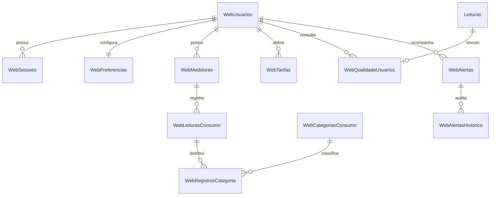

# Modelo e regras da extensão web

A migração `sql/007_web_extension.sql` acrescenta a versão 1 em `dbo.WebSchemaVersions`. O esquema original permanece na versão 3 em `dbo.SchemaVersions`, compatível com a CLI. Nenhuma medida, identificação ou data original é reescrita. A aplicação do script exige backup COPY_ONLY com CHECKSUM e RESTORE VERIFYONLY em banco com leituras; a sessão administrativa informa o backup verificado por SESSION_CONTEXT. O histórico da extensão guarda esse identificador. A migração é transacional e serializada por `sp_getapplock`; objetos preexistentes sem versão exigem revisão, sem adoção silenciosa.

## Entidades

| Tabela | Dados e integridade |
|---|---|
| WebUsuarios | Nome, e-mail com unicidade case-insensitive, hash PBKDF2-SHA256, salt, no mínimo 600000 iterações, administrador, ativo e criação UTC. |
| WebSessoes | Hash do token como PK, proprietário, CSRF, criação e expiração UTC. O token original não é persistido. |
| WebPreferencias | Uma linha por usuário. Limites diário/mensal, limiar para suspeita de consumo contínuo, referências de pH/temperatura/turbidez, unidade, tema e notificações. Referências são nullable. |
| WebMedidores | Proprietário, código único por usuário, nome, unidade m³, status e instalação UTC. Troca cria outro ID; o vínculo ao medidor substituído também valida proprietário. |
| WebLeiturasConsumo | Medidor e usuário com FK composta; DECIMAL(18,3) acumulado em m³; data única por medidor, origem, observações e criação. |
| WebTarifas | DECIMAL(12,4), valor por m³; vigência única por usuário e instante. Histórico imutável na API. |
| WebQualidadeUsuarios | Vínculo exclusivo entre a leitura original em dbo.Leituras e um usuário. Origem WEB ou LEGADO_EXPLICITO. Não duplica medidas. |
| WebCategoriasConsumo | Cinco categorias globais disponíveis: Banho, Lavagem, Cozinha, Sanitários e Outros. Nenhuma possui volume padrão. |
| WebRegistrosCategoria | Volume informado/medido/estimado ligado à leitura final de um intervalo do usuário, com FK composta e origem explícita. |
| WebAlertas | Ocorrência por usuário, tipo, descrição, severidade, status, timestamps e vínculo opcional à leitura. Código de ocorrência único por usuário. |
| WebAlertasHistorico | Status anterior/novo, instante e observação. FK composta garante que o usuário do histórico é o proprietário do alerta. |

`dbo.Alertas` original continua disponível. Sua FK obrigatória de sensor/local e seu contrato de status ABERTO/ENCERRADO não representam alertas de hidrômetros por usuário com ABERTO/EM_ANALISE/RESOLVIDO. Por isso a tabela web tem responsabilidade distinta e preserva integralmente a tabela original.

## Consumo

O módulo C `backend/consumption.c` interpreta números por aritmética inteira. Uma leitura m³ com três casas decimais corresponde exatamente a litros inteiros: 12.345 m³ = 12345 L. Não aceita sinal negativo, expoente, vírgula, mais de três casas nem valores além de DECIMAL(18,3). O cálculo entre medidores diferentes é proibido: a substituição começa outra sequência com consumo desconhecido na primeira leitura.

A inserção no SQL Server bloqueia a linha do medidor e o histórico correspondente durante a transação. Data repetida, entrada anterior à última leitura, contador reduzido e medidor inativo retornam HTTP 409. Data anterior à instalação também é rejeitada. Leituras e instalações posteriores ao relógio UTC do servidor, com tolerância de 60 segundos, retornam HTTP 422. Leitura inicial tem `consumo_litros: null`; contador igual em instantes diferentes representa zero real. A API nunca interpreta o total acumulado como consumo do período.

As consultas calculam `LAG` por medidor antes do filtro temporal. Assim, uma leitura cuja predecessora está fora do período continua a possuir a diferença correta. Filtros usam início incluso e fim exclusivo, datas UTC e ordenação `ordem=asc|desc` para histórico. Sem filtro explícito, o fim corresponde à meia-noite UTC seguinte, abrangendo o dia atual e alertas criados durante a requisição. Paginação aceita page >= 1 e page_size entre 1 e 100.

Cada diferença é atribuída ao dia/mês da leitura final. Um intervalo longo não é dividido entre datas sem medição. Série sem intervalos retorna array vazio; períodos sem consumo calculável retornam total e média null. Séries registradas com consumo zero preservam zero. DECIMAL é retornado como string, sem arredondamento binário no transporte.

A média diária observada divide o total pela soma das durações dos intervalos medidos, em dias. Mais de um medidor contribui também com sua duração; o DTO explica essa base e não trata o número como média de todos os dias do calendário. A comparação usa um intervalo anterior da mesma duração em segundos; ausência de volume anterior ou base zero mantém a variação percentual null.

## Estimativa e categorias

A estimativa financeira soma os custos de cada intervalo: litros / 1000 × a última tarifa com vigência iniciada até a data da leitura final do intervalo. Tarifa zero é válida. Se qualquer intervalo calculável não possui tarifa vigente, a estimativa total é null e intervalos_sem_tarifa informa a cobertura ausente. tarifas_aplicadas detalha vigências, volumes e estimativas parciais; os campos de tarifa única retornam null quando mais de uma tarifa é aplicada. Cada linha histórica também informa tarifa, vigência e custo decimal com sete casas, preservando precisão antes do arredondamento do total para centavos. A comparação financeira usa o período anterior da mesma duração, aplica suas vigências próprias e retorna null quando há cobertura ausente ou base zero. Não há inferência de taxas fixas, cobrança de esgoto ou faixas progressivas.

Categorias possuem volumes apenas após registro explícito. A transação de classificação bloqueia a leitura e os registros dela, garantindo que a soma não exceda sua diferença acumulada. Primeira leitura não pode ser classificada; zero não permite volume positivo. A consulta mantém a origem por categoria e não cria percentuais fictícios nem preenche o volume não classificado.

## Qualidade e legado

A validação de temperatura, pH e turbidez reaproveita `input_valid_measurement`: temperatura -20 a 100 °C, pH 0 a 14 e turbidez não negativa, todos finitos e dentro da representação FLOAT(53). A leitura em dbo.Leituras e o vínculo em WebQualidadeUsuarios são inseridos na mesma transação. A autorização de consulta usa sempre o vínculo do usuário autenticado.

A importação de legado é explícita e exige administrador. Apenas leituras ainda sem proprietário recebem vínculo; medidas, IDs, horários e dados de procedência permanecem intactos. A primeira conta pode escolher esse vínculo no cadastro. Horários sem confirmação UTC têm `registrado_em_utc: null` na API, com `registrado_em` original e `horario_confirmado_utc: false`; filtros UTC excluem esses registros. Histórico sem filtro inclui esses dados e seu aviso de origem. O painel informa a última leitura conhecida do usuário, independentemente do filtro de consumo.

Referências de qualidade começam null. A classificação distingue SEM_DADOS, SEM_REFERENCIA, DENTRO_LIMITES_CONFIGURADOS e FORA_LIMITES_CONFIGURADOS. Esses estados avaliam somente os parâmetros disponíveis; nenhum deles certifica potabilidade.

## Alertas e auditoria

A consulta do painel, alertas ou relatórios de alertas avalia os registros persistidos contra as preferências atuais e grava novas ocorrências. As ocorrências existentes e seus status não são substituídos ao editar referências.

- Consumo elevado: volume observado atribuído ao dia/mês acima de limite explicitamente configurado. Há uma ocorrência por usuário e período.
- Possível vazamento: quatro leituras do mesmo medidor formando três intervalos consecutivos de 1 a 3600 segundos, todos acima do limiar configurado de litros/minuto. Há no máximo uma ocorrência por dia e medidor. Leituras esparsas não sustentam esse alerta; o texto informa que se trata de indício.
- Qualidade: parâmetro medido fora de referência configurada. Há uma ocorrência por leitura e parâmetro. Sem referências não se cria alerta.

Criação e transição de status gravam WebAlertasHistorico. Repetir o mesmo status não cria transição fictícia. Resolver um alerta não faz sua ocorrência reaparecer; o código único independe do status. Os timestamps representam geração/alteração do alerta, enquanto seus vínculos identificam as medidas de origem.

## Privilégios

A role `agua_web` recebe SELECT apenas nos objetos necessários, INSERT em registros novos, UPDATE em usuários/preferências/medidores/alertas e DELETE somente em sessões. O acesso a dbo.Leituras é SELECT/INSERT; não há UPDATE/DELETE de histórico ou medidas. Sensores, locais e versões originais são apenas lidos. A role original `agua_app` não é alterada.

O usuário de banco web não é administrador. A API isola dados pelo WebUser.id autenticado em todas as consultas; um usuario_id enviado pelo cliente não escolhe outro proprietário. Os privilégios da role se aplicam à API confiável; não constituem isolamento por linha para acesso SQL direto, que não é disponibilizado aos usuários do navegador.

## Evidências locais do módulo

Compilação efetivamente executada com Clang, C11, `-Wall -Wextra -Wpedantic -Wconversion -Werror`: backend/web_domain.c e backend/consumption.c, sem avisos. O teste puro tests/web/test_consumption.c executou 38 verificações APROVADAS de precisão, fronteiras, primeira leitura, zero, duplicidade, ordem, contador reduzido, substituição e indício com frequência suficiente. Esses resultados não substituem os testes HTTP/SQL Server reais, registrados pela integração final.

A integração HTTP final executou 19 métodos de tests/web/test_api.py em 9,875 segundos contra MonitoramentoAguaTest (localhost:8081), todos APROVADOS. A suíte exige confirmar esse nome pela rota health antes de gravar, cria contas únicas e preserva o histórico de teste. Foram verificados consumo exato no maior contador, bordas do filtro, troca, tarifas por vigência e cobertura ausente, comparação financeira, limites de categorias, qualidade, isolamento de dois usuários, preferências Unicode/UTF-16, alertas sem duplicidade e auditoria, relatórios vazios, CSRF, Origin/Host, parser, login, revogação e limite de tentativas. Novos textos de alertas preservaram “Indício” e “atribuído” corretamente. O núcleo também foi executado com AddressSanitizer e UndefinedBehaviorSanitizer: 38 verificações APROVADAS sem diagnóstico. Expiração temporal completa de uma sessão após uma hora, indisponibilidade controlada do banco e concorrência sob carga não são alegadas por essa suíte; ela verifica rejeição de sessão inexistente e revogação por logout.
